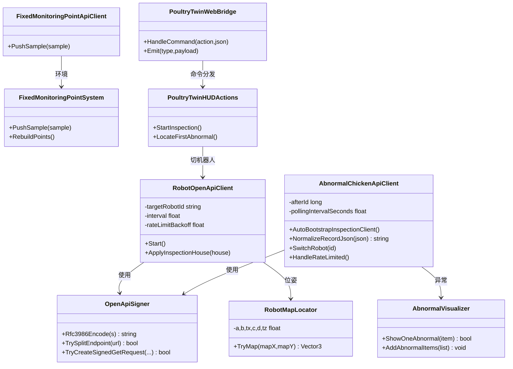

# 鸡舍巡检数字孪生系统 · 开发文档

> 文档类型：开发文档（对应《毕业生项目系统等成果归集要求》2.1）
> 系统名称：鸡舍巡检数字孪生系统（PoultryTwin）
> 适用对象：今后接手本课题的老师 / 新进实验室研究生
> 一句话定位：本文档是开发者蓝图，说明系统「如何实现」；配合源代码可在不依赖作者的情况下读懂并修改系统。

---

## 目录

- [1 开发思路框架](#1-开发思路框架)
- [2 技术栈](#2-技术栈)
- [3 模块设计](#3-模块设计)
- [4 数据库设计](#4-数据库设计)
- [5 项目结构层次](#5-项目结构层次)
- [6 关键算法模块说明](#6-关键算法模块说明)
- [7 API 接口文档](#7-api-接口文档)
- [8 安全性设计](#8-安全性设计)
- [9 术语表与数据字典](#9-术语表与数据字典)
- [10 与系统源代码的对应关系](#10-与系统源代码的对应关系)
- [11 如何编译打包](#11-如何编译打包)

---

## 1 开发思路框架

### 1.1 系统要解决的问题

鸡舍巡检机器人由云端下发巡检任务并实际行走、拍摄。本系统的职责**不是发起巡检**，而是：

1. 把真实鸡舍、笼位、机器人、固定监测点还原成 Unity 三维场景；
2. 通过开放接口把机器人实时位姿、巡检异常、环境数据持续接入场景；
3. 在三维空间中把异常鸡、环境告警定位到具体笼位；
4. 以 WebGL 形式嵌入 Web 后台，与管理系统双向联动。

### 1.2 整体框架图

```mermaid
graph TB
    subgraph 现场层
        ROBOT[巡检机器人<br/>思岚底盘]
        SENSOR[固定监测点<br/>温湿度/CO2/氨气传感器]
    end

    subgraph 云端平台层[RuoYi 后端 · {host}:{port}]
        GW[开放接口网关 /open/**<br/>appKey + HMAC 签名]
        STATUS[/open/robot/status<br/>机器人实时位姿/状态]
        EXC[/open/inspection-exception/by-robot<br/>按机器人查巡检异常]
        DBAPI[/open/db/query<br/>通用白名单读表]
        MON[/open/monitor/points/latest<br/>监测点最新值]
        CTRL[/open/robot/move /charge /stop<br/>底盘控制开放接口]
        DB[(MySQL<br/>robot_info / sys_house<br/>inspection_exception<br/>monitor_point_*)]
        GW --- STATUS
        GW --- EXC
        GW --- DBAPI
        GW --- MON
        GW --- CTRL
        STATUS --- DB
        EXC --- DB
        DBAPI --- DB
        MON --- DB
        CTRL -.内网HTTP.-> ROBOT
    end

    subgraph 孪生表现层[Unity 2021.3.44f1c1 · WebGL]
        BRIDGE[PoultryTwinBridge<br/>WebBridge 命令/事件总线]
        HUD[PoultryTwinHUD<br/>视角/面板/异常列表]
        RLOC[RobotMapLocator<br/>地图坐标→Unity坐标]
        VIS[AbnormalVisualizer<br/>异常鸡三维标记]
        MONV[FixedMonitoringPointSystem<br/>监测点卡片与告警]
        RC[RobotOpenApiClient]
        AC[AbnormalChickenApiClient]
        MC[FixedMonitoringPointApiClient]
        SIGN[OpenApiSigner<br/>HMAC-SHA256]
        RC --> RLOC --> BRIDGE
        AC --> VIS --> BRIDGE
        MC --> MONV --> BRIDGE
        HUD --> BRIDGE
        RC & AC & MC --> SIGN
    end

    subgraph Web后台层
        VUE[Vue / React 管理后台]
        IFRAME[UnityTwin 组件<br/>iframe + postMessage]
        VUE <--> IFRAME
    end

    ROBOT -.上报.-> STATUS
    SENSOR -.上报.-> MON
    EXC --> AC
    STATUS --> RC
    MON --> MC
    DBAPI -.配置类数据.-> HUD
    IFRAME <--> BRIDGE
```

### 1.3 数据流主链路

```
云端下发巡检指令 → 机器人行走拍摄 → 异常数据落 inspection_exception 表
        ↓
Unity AbnormalChickenApiClient 每 3 秒增量拉取（afterId 游标）
        ↓
字符串级 JSON 规范化（null→0、数字→字符串）→ JsonUtility 反序列化
        ↓
异常坐标经 RobotMapLocator 仿射变换 / 行列层换算 → 三维笼位
        ↓
AbnormalVisualizer 生成标记，PoultryTwinHUD 刷新计数与列表
        ↓
WebBridge 以 abnormal-counts / snapshot 事件推送到 Web 后台
```

### 1.4 三条设计原则

| 原则 | 说明 | 代码体现 |
|---|---|---|
| 孪生端只读、不发起巡检 | 巡检由云端发起；客户端只接入与展示，控制类接口单独鉴权 | `autoStartOnPlay` 自动接入；HUD 的开始/停止按钮走 `startInspection` 命令 |
| 后端代查、WebGL 不直连数据库 | WebGL 无 TCP socket、无线程、驱动不兼容、凭据会泄露 | `DatabaseTableClient` → HTTP `/open/db/query` → 白名单读表 |
| 配置驱动、少改代码 | 点位、指标、查询、接口地址全部走 Resources/*.json | `MonitoringPointConfig.json` / `DatabaseQueryConfig.json` / `RobotBackendConfig.json` |

---

## 2 技术栈

### 2.1 版本清单

| 层次 | 技术 / 组件 | 版本 | 说明 |
|---|---|---|---|
| 三维引擎 | Unity | 2021.3.44f1c1 (0c301d0bd4e3) | LTS，C# 脚本 |
| 脚本语言 | C# | .NET Standard 2.1（apiCompatibilityLevel 6） | 58 个 .cs + 3 个 .jslib |
| UI | UGUI + TextMesh Pro | com.unity.ugui 1.0.0 / textmeshpro 3.0.6 | HUD 全部在 Unity 内 |
| 网络 | UnityWebRequest | com.unity.modules.unitywebrequest 1.0.0 | 无第三方网络库 |
| 构建目标 | WebGL | Brotli 压缩（webGLCompressionFormat 2），512 MB 内存 | 模板 PROJECT:PoultryTwin |
| 后端框架 | Spring Boot / RuoYi-Vue-Plus | 5.x（Spring Boot 3 / JDK 17） | Spring Boot 2 需把 jakarta.* 改回 javax.* |
| 数据库 | MySQL | 8.x（utf8mb4 / utf8mb4_unicode_ci） | 具体小版本需与生产库核对 |
| 数据访问 | JdbcTemplate / MyBatis | Spring Boot 自动装配 | 白名单 + 预编译 SQL |
| 本地联调 | Python | 3.8+（纯标准库） | 3 个 mock_server，无需装数据库 |
| 前端 | Vue 3 / React 18 + TypeScript | — | iframe 或直连两种嵌入模式 |
| Web 服务器 | Nginx | ≥1.18 | 需配 .wasm MIME、COOP/COEP、反向代理 |
| 通信协议 | HTTP/1.1 + JSON | — | postMessage（iframe）/ SendMessage（直连） |
| 鉴权 | appKey + HMAC-SHA256 签名 | 自研七段式 | /open/** 全部走签名拦截器 |
| 版本控制 | Git | — | 建议按 2.16 用 Git 管理 |

### 2.2 依赖版本出处

- Unity 版本：`ProjectSettings/ProjectVersion.txt`
- Unity 包版本：`Packages/manifest.json`
- 后端框架版本：`backend-open-robot-api/README.md`（RuoYi-Vue-Plus 5.x / JDK 17）
- 数据库字符集：归集包 `1.3.6-数据库/schema.sql`

> 说明：项目未使用 URP/HDRP、Addressables、Netcode 等包；渲染为 Unity 内置管线。

---

## 3 模块设计

### 3.1 功能模块分解

系统按「端」分为四大子系统，共 12 个模块：

| 子系统 | 模块 | 职责 | 核心文件 |
|---|---|---|---|
| 孪生场景 | 鸡舍生成器 | 参数化生成排/列/层笼舍与编号 | `CageHouseGenerator.cs` |
| 孪生场景 | 机器人定位 | 地图坐标→Unity 坐标仿射变换、平滑移动 | `shiyanshi/RobotMapLocator.cs` |
| 孪生场景 | 监测点系统 | P01~P04 卡片、告警判定、布局重建 | `FixedMonitoringPointSystem.cs` |
| 数据接入 | 位姿接入 | 轮询 `/open/robot/status`，交给定位模块 | `shiyanshi/RobotOpenApiClient.cs` |
| 数据接入 | 异常接入 | 按机器人增量拉异常、规范化、清场 | `yichangweizhi/AbnormalChickenApiClient.cs` |
| 数据接入 | 环境接入 | 多数据源、字段映射、扩展指标 | `FixedMonitoringPointApiClient.cs` |
| 数据接入 | 通用读表 | 白名单查询配置类数据 | `Database/DatabaseTableClient.cs` |
| 数据接入 | 签名 | 七段式 HMAC-SHA256 签名、URL 处理 | `Common/OpenApiSigner.cs` |
| 可视化 | 异常可视化 | 三维标记、信息面板、Excel 导出 | `yichangweizhi/AbnormalVisualizer.cs` 等 11 个 |
| 交互 | HUD | 视角切换、面板抽屉、异常列表、语言 | `UI/` 下 8 个 |
| 集成 | WebBridge | 18 命令 / 11 事件、命令队列、ack | `WebGl/` 下 5 个 + jslib |
| 工具 | 构建工具 | 一键检查与构建 WebGL 到前端目录 | `Editor/WebGLBuildTool.cs` |

### 3.2 核心类说明

#### 3.2.1 CageHouseGenerator — 鸡舍生成器

- **职责**：按「排 row × 列 column × 层 layer」参数化生成笼舍实体与编号。默认 `rowCount=7`、`columnCount=63`、`layerCount=4`。
- **关键函数**：
  - `TryConvertDisplayToInternal(int row, int cage)`：把展示编号（1-based）转成内部索引，**要求 `row≥1 && cage≥1`**，否则返回 false。这是异常鸡能否落到笼位的前置条件。
  - 前后 / 左右编号翻转：只改变编号语义，不移动实体。
- **注意**：编号差异是「显示层从 1 开始、内部数组从 0 开始」，换算必须 `+1` / `-1`，写反会导致异常鸡整体错位一排。

#### 3.2.2 RobotMapLocator — 机器人坐标标定

- **职责**：把机器人上报的地图坐标 `(mapX, mapY)` 经仿射变换映射到 Unity 场景坐标 `(X, Z)`。
- **关键公式**：
  ```
  UnityX = a*mapX + b*mapY + tx
  UnityZ = c*mapX + d*mapY + tz
  ```
- **场景实标定参数**（`论文.unity`）：a=0.78308153, b=−0.3633739, tx=5.434616；c=0.06841556, d=1.9504602, tz=−2.0458252；`groundLocalY=0.25`。
- **4 个标定点**：charge(1.29,3.26)、first(1.4,−2)、scend(4.8,3.26)、four(4.79,−2)，覆盖地图 x 1.29~4.8、y −2~3.26。
- **关键函数**：`TryMap()` 做仿射变换；`snapDistance=3`、`maxMoveSpeed=0.35` 控制平滑移动；`headingMode=ApiAngel`、`robotYawOffsetDeg=180` 处理朝向。

#### 3.2.3 AbnormalChickenApiClient — 异常数据接入（最复杂模块）

- **职责**：按 `robotId` 增量拉取巡检异常，规范化后交给可视化模块；机器人切换时清场、游标归零。
- **默认接口**：`http://{host}:{port}/open/inspection-exception/by-robot`
- **关键机制**：
  - **自动接入**：`[RuntimeInitializeOnLoadMethod(AfterSceneLoad)]` + `autoStartOnPlay=true`，进 Play 自动找到 `AbnormalVisualizer` 并挂载，无需手动挂组件。
  - **增量游标**：`afterId` + `truncated` 续拉，单次上限 10 次，避免一次拉爆。
  - **轮次检测**：本轮收到过数据 + 连续 2 次空响应 → 判定云端已清库 → 清标记、`afterId=0`。
  - **限流退避**：`pollingIntervalSeconds=3`（约 20 次/分钟，与状态接口合计约 80 次/分钟，低于平台 120 次/分钟配额）；429 时退避倍数 ×2（上限 8），成功后 ×0.5 收回。
  - **字符串级规范化 `NormalizeRecordJson`**：按 key 白名单改写字面量，不改 JSON 结构。两套规则并行：
    - `toText`：`exceptionPosX` / `exceptionPosY` / `exceptionJudgmentValue` 数字→字符串（应对实测返回字符串）；
    - `nullToZero`：`rowNo` / `colNo` / `tierNo` 的 `null`→`0`（应对 `JsonUtility` 遇 null 抛 `Invalid value` 整批丢数据的陷阱）。
- **重要**：实测 `rowNo=-2`、`colNo=null`，无法落到真实笼位，当前策略是**不展示到具体笼位**，仅统计与列表展示，日志为信息级。

#### 3.2.4 OpenApiSigner — 开放接口签名

- **职责**：为所有 `/open/**` 请求生成 HMAC-SHA256 签名。
- **待签字符串（七段，`\n` 分隔，末行无换行）**：
  ```
  appKey
  timestamp
  nonce
  METHOD
  path
  canonicalQuery
  bodySha256
  ```
- **关键函数**：
  - `Rfc3986Encode()`：RFC 3986 编码（`~` 不编码，空格 `%20`）。
  - `TrySplitEndpoint()`：剥离 nginx 的 `/prod-api` 前缀——网关前缀不参与签名。
  - `TryCreateSignedGetRequest()`：合并已有 query 与新增参数，key 升序排列后拼 canonicalQuery。
- **空 body 哈希**固定为 `e3b0c44298fc1c149afbf4c8996fb92427ae41e4649b934ca495991b7852b855`。
- 签名结果转**小写 hex**，放在 `X-Sign` 头；另有 `X-App-Key` / `X-Timestamp` / `X-Nonce`。

#### 3.2.5 PoultryTwinWebBridge — WebBridge 总线

- **职责**：Web ↔ Unity 的唯一通信枢纽。`HandleCommand` 用 switch 分发 18 个 action；`Emit` 上报 11 类事件。
- **Web→Unity**：`unityInstance.SendMessage("PoultryTwinBridge","HandleCommand",json)`。
- **Unity→Web**：`[DllImport("__Internal")] PT_NotifyWeb(type,json,targetOrigin)`，jslib 里优先 `window.parent.postMessage`，其次 `window.PoultryTwinHost.onMessage`。
- **挂载**：`WebBridgeBootstrap` 在 `AfterSceneLoad` 自动挂载（场景有 `PoultryTwinHUDController` 且无桥接组件且 `enabled != false`）。配置走 `Assets/Resources/WebBridgeConfig.json`（因为桥接组件不在场景文件里，Inspector 改动不保存）。

### 3.3 模块关系图（类图）



---

## 4 数据库设计

数据库完整设计见同目录 `1.3.6-数据库/数据库设计说明.md`，脚本见 `schema.sql` / `data.sql`。此处给出与开发相关的概要。

### 4.1 表清单

| 表名 | 用途 | 主键 | 备注 |
|---|---|---|---|
| `robot_info` | 机器人 IMEI → 栋舍绑定 | robot_id（需核对） | `robotId → houseCode` 链路源头 |
| `sys_house` | 栋舍台账 | house_code（需核对） | 巡检/监测的归属维度 |
| `inspection_exception` | 巡检异常明细 | inspection_exception_id | 增量游标表，核心查询表 |
| `monitor_point_latest` | 监测点最新值 | (point_id, house_code) | UPSERT 写入 |
| `monitor_point_history` | 监测点历史明细 | id | 趋势与报表 |
| `sys_dict_data` | 系统字典 | dict_code（需核对） | 下拉与状态文案 |

### 4.2 核心查询与索引

```sql
-- by-robot 的查询模式，必须建复合索引
SELECT ... FROM inspection_exception
WHERE house_code = ? AND inspection_exception_id > ?
ORDER BY inspection_exception_id ASC LIMIT ?;

CREATE INDEX idx_inspection_house_id
  ON inspection_exception (tenant_id, house_code, inspection_exception_id);
```

> **重要**：生产库中异常表的字段命名存在多套版本（`id` vs `inspection_exception_id`、`row_no/col_no/tier_no` vs `exception_row_no/...`），且实测字段类型与文档声明不一致（坐标/置信位为字符串、colNo 为 null）。`schema.sql` 已标注需要核对项；这些差异必须在应用层做容错，不能只靠数据库约束。

---

## 5 项目结构层次

系统采用「表现层—接入层—领域层—数据层」四层结构（对应 MVC 思想的 View / Controller / Model 变体）：

| 层次 | 对应 MVC | 目录 / 文件 | 职责 |
|---|---|---|---|
| 表现层 View | View | `Assets/Script/UI/`、`Assets/Script/yichangweizhi/AbnormalVisualizer.cs`、WebGL 模板 | HUD、三维标记、面板、卡片，只负责显示与交互 |
| 接入层 Controller | Controller | `Assets/Script/WebGl/`、`shiyanshi/`、`yichangweizhi/*ApiClient.cs`、`Database/` | 命令分发、HTTP 请求、签名、解析、缓存 |
| 领域层 Model | Model | `FixedMonitoringPointSystem.cs`、`CageHouseGenerator.cs`、`RobotMapLocator.cs`、`MonitoringPointTypes.cs` | 业务规则：告警判定、笼位生成、坐标映射、数据结构 |
| 数据层 | Model | `Assets/Resources/*.json`、后端 MySQL、mock_server.py | 配置、持久化、联调数据 |

后端采用 RuoYi 分层：`Controller`（参数校验）→ `Service`（业务逻辑 + 缓存 + SQL）→ `JdbcTemplate/MyBatis`（数据访问）。

---

## 6 关键算法模块说明

### 6.1 七段式 HMAC 签名算法

```
stringToSign = appKey + "\n" + ts + "\n" + nonce + "\n"
             + METHOD + "\n" + path + "\n" + canonicalQuery + "\n" + bodySha256
sign = HMAC-SHA256(key=appSecret, data=stringToSign) → 小写 hex
```

- 时间戳为 Unix 秒级，后端校验偏差 ±5 分钟；nonce 16 位随机串，Redis 存 5 分钟防重放。
- 参数按 key 的 ASCII 升序；path 不含域名与 query；`/prod-api` 前缀须剥离。
- 该算法与本地脚本 `tools/check_inspection_api.py`、各后端 README 的算例逐位一致，已在真实接口上验证（正确签名 200，错误 secret 返回 401）。

### 6.2 增量游标与轮次检测

- 每次请求带 `afterId=上次 lastId`，只返回新增记录；`truncated=true` 时继续拉，最多 10 次。
- 云端下发巡检指令会清空该栋舍数据。客户端用「本轮收到过数据 + 连续 2 次空响应」判定清库，自动把 `afterId` 归零，开始新一轮。
- 该机制是为了适配「巡检在云端发起」的业务前提，无需人工在孪生端操作。

### 6.3 字符串级 JSON 规范化

`JsonUtility` 是强类型反序列化：字段声明为 `int` 却遇到 `null`，会抛 `Invalid value` 导致**整批记录被丢弃**。实测异常表中 `exceptionColNo` 14/14 为 null、`posX/Y` 与 `judgmentValue` 为字符串。解决办法是在反序列化前做字符串级改写：

```
{"exceptionPosX":11.63}      → {"exceptionPosX":"11.63"}     （toText）
{"colNo":null}               → {"colNo":0}                   （nullToZero）
```

按 key 白名单改写字面量，不改结构，避免引入 JSON 库依赖（WebGL 下尽量少依赖）。

### 6.4 坐标映射与笼位换算

- 机器人位姿：`RobotMapLocator` 仿射变换（见 3.2.2）。
- 异常鸡落位：优先用 `rowNo/colNo/tierNo` 经 `CageHouseGenerator` 换算（要求 ≥1）；若无有效行列层，则尝试地图坐标；实测数据两者都不可用时不落到具体笼位，只做统计展示。

### 6.5 限流与退避

平台配额：同一 appKey 120 次/分钟。之前巡检 0.6 秒（100 次/分）+ 状态 0.4 秒（150 次/分）合计 250 次/分，触发 429。现调整为：

- 巡检 3 秒（约 20 次/分）+ 状态 1 秒（60 次/分）+ 其他，合计约 80 次/分；
- `RobotOpenApiClient.MinimumPollingInterval = 1f` 硬下限，低于 1 秒强制抬升；
- 429 时 `rateLimitBackoff` ×2（上限 8/6），成功后 ×0.5 收回。

---

## 7 API 接口文档

### 7.1 基本信息

| 项 | 值 |
|---|---|
| Base URL | `http://{host}:{port}` |
| 网关前缀 | 部署环境可能为 `/prod-api`（**签名时不包含此前缀**） |
| 认证方式 | API Key（`X-App-Key`）+ HMAC-SHA256 签名（`X-Sign`），头还有 `X-Timestamp`、`X-Nonce` |
| 数据格式 | 请求 query / JSON；响应 JSON `{code, msg, data}` |
| 成功码 | `code=200`（部分接口 `0` 也算成功） |

> 密钥不在文档中明文列出；开发联调使用的 appKey/appSecret 按组下发，见部署文档配置模板。

### 7.2 接口列表

| 端点 | 方法 | 功能 | 调用方 | 轮询/触发 |
|---|---|---|---|---|
| `/open/robot/status` | GET | 单机器人实时位姿与状态 | RobotOpenApiClient | 1~3 秒 |
| `/open/robot/status/list` | GET | 机器人列表与状态 | RobotOpenApiClient | 低频 |
| `/open/inspection-exception/by-robot` | GET | 按机器人查巡检异常（robotId→houseCode→异常） | AbnormalChickenApiClient | 3 秒 |
| `/open/db/query` | GET | 通用白名单读表 | DatabaseTableClient | 按需 |
| `/open/monitor/points/latest` | GET | 监测点最新环境值 | FixedMonitoringPointApiClient | 5 秒 |
| `/open/monitor/points/upload` | POST | 传感器上报环境值 | 传感器/网关 | 3~10 秒 |
| `/open/robot/move` | GET | 机器人方向移动 | HUD / WebBridge | 手动 |
| `/open/robot/charge` | GET | 返回充电 | HUD / WebBridge | 手动 |
| `/open/robot/stop` | GET | 急停 | HUD / WebBridge | 手动 |

### 7.3 重点接口：按机器人查巡检异常

**请求**

```
GET /open/inspection-exception/by-robot?robotId={ROBOT_IMEI_A}&afterId=0
```

| 参数 | 位置 | 必填 | 类型 | 含义 |
|---|---|---|---|---|
| `robotId` | Query | 是 | string | 机器人 IMEI，如 `B{ROBOT_IMEI_C}` |
| `afterId` | Query | 否 | long | 增量游标，默认 0；之后传上次返回的 lastId |
| `tenantId` | Query | 视环境 | string | 租户隔离，如 `000000` |
| `pageSize` | Query | 否 | int | 默认 200，上限 500 |

请求头：

```
X-App-Key: <appKey>
X-Timestamp: <Unix秒>
X-Nonce: <16位随机串>
X-Sign: <小写hex签名>
Content-Type: application/json
```

**成功响应（200）**

```json
{
  "code": 200,
  "msg": "success",
  "data": {
    "houseCode": "50",
    "robotId": "{ROBOT_IMEI_A}",
    "records": [
      {
        "inspectionExceptionId": 2917330,
        "exceptionTypeId": 1,
        "exceptionTypeName": "死鸡异常",
        "exceptionFileName": "d3.jpg",
        "exceptionFilePath": "http://.../profile/upload",
        "exceptionJudgmentValue": "0.74",
        "exceptionPosX": "11.630",
        "exceptionPosY": "5.800",
        "rowNo": -2,
        "colNo": null,
        "tierNo": 2,
        "syncTime": "2026-10-29 08:15:00"
      }
    ],
    "lastId": 2917343,
    "total": 14,
    "truncated": false
  }
}
```

> 注意：以上是**真实接口实测形态**——`houseCode` 为字符串、`posX/Y` 与 `judgmentValue` 为字符串、`colNo` 为 null。文档原始速查中写的 decimal 类型与实测不符，客户端已做兼容。

**错误响应**

| HTTP / code | msg | 含义与客户端表现 |
|---|---|---|
| 401 | 签名错误 | appKey/nonce/时间戳不匹配；画面保留上次数据 |
| 404 | No endpoint | 路由未部署（上线前曾出现，后端部署后恢复 200） |
| 429 | 请求过于频繁 | 触发限流；客户端指数退避，不丢弃数据 |
| 500 | 机器人 xxx 没有绑定栋舍 | 绑定表缺记录，需后端维护 |
| 500 | robotId 不能为空 | 参数校验失败 |

**请求示例（curl，含签名需先算 header）**

```bash
# 本地已有签名工具，可直接复算与实测：
python tools/check_inspection_api.py --robot {ROBOT_IMEI_A} --follow

# 手工请求（把四项签名头换成实际值）
curl -s "http://{host}:{port}/open/inspection-exception/by-robot?robotId={ROBOT_IMEI_A}&afterId=0" \
  -H "X-App-Key: <appKey>" -H "X-Timestamp: <ts>" \
  -H "X-Nonce: <nonce>" -H "X-Sign: <sign>"
```

### 7.4 其他接口摘要

**`/open/robot/status`**（实时位姿）

| 参数 | 含义 |
|---|---|
| `robotId` | 机器人 IMEI |

返回 `data` 含 `x/y/heading/speed/reportTime/ageMs/online/houseCode`。客户端校验 `hasData`，未定位时显示「等待定位」，不把初始位置当真实位姿。

**`/open/db/query`**（通用读表）

| 参数 | 含义 |
|---|---|
| `table` | 表名，必须在后端白名单内 |
| `columns` | 逗号分隔列；留空返回全部允许列 |
| `w0,w1...` | 条件 `列:op:值`，多条件 AND；op 支持 eq/ne/gt/ge/lt/le/like/in/isNull 等 |
| `orderBy` / `pageNum` / `pageSize` | 排序与分页（pageSize ≤1000） |
| `tenantId` | 多租户表必填 |

> 用 `w0/w1` 而非重复 `where`，是因为 HMAC 签名按键排序拼串时同名参数会互相覆盖。

**`/open/monitor/points/latest`**（监测点最新值）

| 参数 | 含义 |
|---|---|
| `tenantId` | 租户 |
| `houseCode` | 栋舍编号 |

返回 `data` 为点位数组，每项含 `pointId/pointName/temperature/humidity/co2/ammonia/illuminance/syncTime`。未知数字字段自动作为扩展指标展示。

**`/open/robot/move` / `charge` / `stop`**（底盘控制）

| 参数 | 含义 |
|---|---|
| `robotId` | 机器人 IMEI |
| `direction` | 0 前进 / 1 后退 / 2 右转 / 3 左转 |
| `duration` | 动作时长毫秒，默认 800 |

> 控制类接口是写操作，走开放签名后由后端内网转发到底盘 `http://{robot-ip}:1448/api/core/motion/v1/actions`。前端有 0.65 秒节流，后端建议再加幂等。**公网上绝不能做成免签名裸接口**。

---

## 8 安全性设计

### 8.1 认证与鉴权

| 场景 | 方式 | 说明 |
|---|---|---|
| 开放接口 /open/** | appKey + HMAC-SHA256 + 时间戳 + nonce | 时间戳偏差 ±5 分钟；nonce Redis 缓存 5 分钟防重放 |
| 后台管理接口 /system/** | Bearer Token（RuoYi 登录态） | 控制类接口原本在此，现已开放签名版 |
| WebBridge 消息 | `targetOrigin` 校验来源 | 默认 `*`，**上线前必须改成实际域名** |
| 数据库读 | 白名单 + 预编译 SQL + 租户隔离 | 只 SELECT，无任意 SQL 参数 |

### 8.2 已识别风险与处理

| 风险 | 说明 | 处理 |
|---|---|---|
| appSecret 硬编码 | WebGL 产物中密钥可被反编译提取 | 源码注释已标注；生产应由服务端代理签名/请求，密钥不下发客户端 |
| targetOrigin=`*` | 任何页面可给 iframe 发命令 | 部署文档列为上线前必改项 |
| 混合内容 | https 页面请求 http 接口被拦 | 接口上 https 或同域反向代理 |
| SQL 注入 | 读表接口若接受原始 SQL 极危险 | 不提供 `sql=` 参数；表名/列名/排序走白名单 + 正则 `^[A-Za-z_][A-Za-z0-9_]*$`；值用 `?` 绑定 |
| 拖库 | 通用查询接口若无限流 | 分页上限 1000；同 IP 60 次/分钟；敏感表不进白名单 |
| 机器人被恶意控制 | 控制接口暴露公网 | 必须签名；前端节流 + 后端幂等；测试前确认周边无人 |

### 8.3 二次验证

当前系统**不含**二次验证（无短信/邮箱/OTP）。开放接口依赖签名 + 时间戳 + nonce 三重机制；后台管理沿用 RuoYi 的账号密码登录。若需等保或甲方要求，可在 `/system/**` 管理端增加二次验证，开放接口不建议加（会影响 3 秒轮询的自动化）。

---

## 9 术语表与数据字典

| 术语 / 缩写 | 含义 |
|---|---|
| PoultryTwin | 本数字孪生系统 productName |
| WebBridge | Unity 与 Web 之间的命令/事件通信层 |
| action / 命令 | Web → Unity 的操作指令（如 startInspection） |
| event / 事件 | Unity → Web 的状态上报（如 robot-pose） |
| afterId / lastId | 增量拉取游标 / 本次返回的最大记录 ID |
| truncated | 本次未拉完、需继续续拉的标记 |
| houseCode | 栋舍编号（实测为字符串，如 `"50"`） |
| 排 row / 列 column / 层 tier | 笼位三维编号；显示 1-based，内部索引 0-based |
| mapX / mapY | 机器人地图坐标；经仿射变换转 Unity 的 X/Z |
| 仿射变换 | 6 参数 (a,b,tx,c,d,tz) 的平面坐标映射 |
| appKey / appSecret | 开放接口的应用标识 / 应用密钥 |
| nonce | 一次性随机串，防重放 |
| canonicalQuery | 参数按 key ASCII 升序拼成的签名用查询串 |
| toText / nullToZero | 异常 JSON 规范化的两类规则 |
| WebGL | Unity 的浏览器构建目标 |
| postMessage | iframe 父子页面通信 API |
| SendMessage | Unity 实例接收 JS 调用的入口 |
| RuoYi | 项目采用的 Java 后台框架 |
| P01~P04 | 四个固定监测点编号（前区左/右、后区左/右） |
| hasData | 位姿是否为真实数据；false 表示尚未定位 |

---

## 10 与系统源代码的对应关系

### 10.1 文档章节 → 源文件索引

| 本文档章节 | 主要对应源文件 |
|---|---|
| 1 思路框架 | 全文；`Editor/WebGLBuildTool.cs` |
| 2 技术栈 | `ProjectSettings/ProjectVersion.txt`、`Packages/manifest.json` |
| 3 模块设计 | `Assets/Script/` 各子目录（见 3.1 表） |
| 4 数据库设计 | `1.3.6-数据库/*`、`Database/DatabaseTableClient.cs`、后端 `*Service.java` |
| 5 项目结构层次 | `Assets/Script/` 目录结构 |
| 6 关键算法 | `Common/OpenApiSigner.cs`、`AbnormalChickenApiClient.cs`、`RobotMapLocator.cs` |
| 7 API 接口 | 各 `*ApiClient.cs`、`Resources/*.json`、后端 `*Controller.java` |
| 8 安全性 | `WebGl/WebBridgeSettings.cs`、`Assets/Resources/WebBridgeConfig.json`、后端白名单实现 |
| 11 编译打包 | `Editor/WebGLBuildTool.cs`、`web-integration/README.md` |

### 10.2 源码阅读路线建议

1. 先看 `Assets/Resources/*.json` 四个配置文件，了解系统「连哪里、查什么、显示什么」；
2. 再看 `WebGl/WebBridgeMessages.cs` 的 18 命令 / 11 事件，掌握对外契约；
3. 然后按数据链路读三个 ApiClient → `RobotMapLocator` / `AbnormalVisualizer` / `FixedMonitoringPointSystem`；
4. 最后读 `Common/OpenApiSigner.cs` 与后端 `*Service.java`，理解签名与落库。

---

## 11 如何编译打包

### 11.1 Unity WebGL 构建（分项目/分模块）

1. 打开 `My project`（Unity 2021.3.44f1c1）。
2. 菜单 `Tools → 数字孪生 → 检查 WebGL 构建配置`，按提示自动修复（productName 带空格、内存过小、模板未选、压缩格式与服务器不匹配、Run In Background）。
3. 确认 Build Settings 中仅 `Assets/Scenes/论文.unity` 勾选。
4. 菜单 `Tools → 数字孪生 → 一键构建 WebGL 到前端目录`。
5. 产物输出到 `unity0602/web-integration/public/unity/`（关键文件见 `1.3.5-项目编译文件/1.3.5-编译产物说明.md`）。

### 11.2 构建命令（工具内部等价操作）

构建工具通过 `BuildPipeline.BuildPlayer` 完成，固定设置：

- `productName = PoultryTwin`（避免文件名带空格导致 URL 404）
- `WebGLTemplate = PROJECT:PoultryTwin`
- `WebGLMemorySize = 512 MB`
- 场景优先级：论文 → 主场景 → Main → 参赛（取第一个存在且勾选的）

### 11.3 后端编译

```bash
# 参考后端为 RuoYi-Vue-Plus 5.x / JDK 17
mvn clean install                 # 后端 Jar
cd ruoyi-ui && npm install && npm run build:prod   # 前端 dist
```

具体目录以团队实际工程为准；本归集包中的 Java 文件是**接口参考实现**，用于说明对接契约，不单独构成可编译工程（见 `1.3.7-支持文件` 中的说明）。

### 11.4 编译输出清单

| 产物 | 位置 | 说明 |
|---|---|---|
| WebGL 四件套 | `web-integration/public/unity/Build/` | unity.data / wasm / framework.js / loader.js |
| 宿主页 | `web-integration/public/unity/index.html` | iframe 加载入口 |
| 后端 Jar | 团队后端工程 target/ | 非本归集包内编译 |
| Windows 独立版（历史） | `My project/Build/` | 2025-06-03 旧产物，非 WebGL，仅留档 |

### 11.5 常见问题

| 问题 | 原因 | 解决 |
|---|---|---|
| 构建失败：productName 带空格 | 工程名 `My project` 含空格 | 构建工具已强制改为 PoultryTwin |
| 浏览器白屏 | 压缩格式与服务器 MIME 不匹配 | nginx 配 .wasm 为 application/wasm；Brotli 需正确 Content-Encoding |
| 文件名 404 | URL 里 `%20` | 确认 productName 无空格 |
| 导出 Excel 不下载 | iframe 缺下载权限 | 加 `allow="downloads"` 或 sandbox 令牌 |
| 切标签页回来位置跳变 | runInBackground 未开 | 构建检查项已包含 |

---

**文档结束**。配套文档：部署文档、使用文档、数据库设计说明与 SQL 脚本、支持文件总览、编译产物说明、成果汇总简表。
