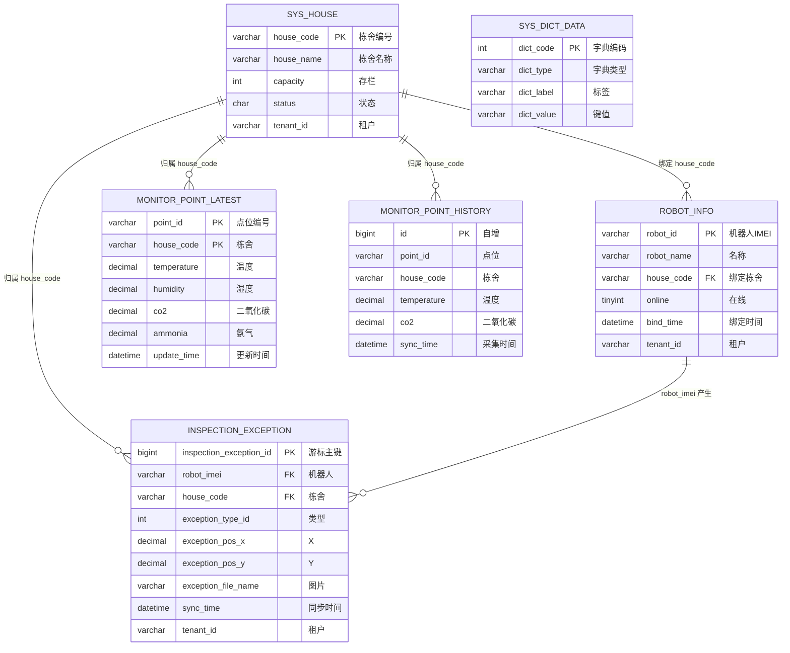

# 鸡舍巡检数字孪生系统 · 数据库设计说明

> 对应《毕业生项目系统等成果归集要求》2.5
> 配套文件：`schema.sql`（建库建表 + 索引 + 约束）、`data.sql`（初始数据）

---

## 目录

- [1 数据库管理系统及版本](#1-数据库管理系统及版本)
- [2 数据库设计说明（ER 与架构）](#2-数据库设计说明er-与架构)
- [3 关键设计说明](#3-关键设计说明)
- [4 数据表结构详解](#4-数据表结构详解)
- [5 数据库文件说明](#5-数据库文件说明)
- [6 数据迁移与备份](#6-数据迁移与备份)
- [7 数据库安全性](#7-数据库安全性)
- [8 实测字段类型差异（必读）](#8-实测字段类型差异必读)

---

## 1 数据库管理系统及版本

| 项 | 值 |
|---|---|
| 数据库管理系统 | MySQL |
| 版本 | 8.x（小版本需与生产库核对） |
| 字符集 | `utf8mb4` |
| 排序规则 | `utf8mb4_unicode_ci` |
| 存储引擎 | InnoDB |
| 访问方式 | Unity（WebGL）不直连；经后端 HTTP 白名单接口 `/open/db/query` 代查 |
| 生产地址 | `http://{host}:{port}`（应用服务器；数据库在内网） |

> **为什么 WebGL 不直连数据库**：WebGL 无 TCP socket（连不上 3306）、无多线程（MySQL 驱动依赖同步 socket）、驱动无 wasm 版本、账号密码会明文进 `.data` 被反编译、且后端无法审计。因此本系统统一走「Unity → HTTP → 后端白名单接口 → 数据库」。

---

## 2 数据库设计说明（ER 与架构）

### 2.1 ER 关系图



### 2.2 架构说明

数据库围绕「栋舍」这个核心维度组织：

- `sys_house` 是主维度表，机器人、异常、监测点都通过 `house_code` 归属到栋舍；
- `robot_info` 维护「机器人 → 栋舍」绑定，是 `robotId → houseCode → 异常` 链路的源头；
- `inspection_exception` 是高频写入、增量读取的事实表，`inspection_exception_id` 作为游标；
- `monitor_point_latest` 用 UPSERT 保存每个点位的最新值（一行一点位），`monitor_point_history` 追加保存历史用于趋势；
- `sys_dict_data` 提供下拉与状态文案，属配置数据。

多租户隔离：业务表普遍带 `tenant_id`（项目示例租户 `000000`），查询时强制带租户条件。

---

## 3 关键设计说明

### 3.1 命名规范

| 对象 | 规范 | 示例 |
|---|---|---|
| 表名 | 小写 + 下划线，单数 | `robot_info`、`inspection_exception` |
| 字段名 | 小写 + 下划线 | `house_code`、`sync_time` |
| 主键 | 业务表用业务键或自增 bigint | `inspection_exception_id`、`id` |
| 索引 | `idx_` 前缀 + 字段缩写 | `idx_inspection_house_id`、`idx_point_time` |
| 外键约束 | 逻辑外键为主，物理约束按生产库情况 | `house_code` 逻辑关联 |

> 注意：API 层使用驼峰字段（`inspectionExceptionId`、`houseCode` 等），那是 Java/C# DTO 与 `AS` 别名，**不是数据库列名**。数据库一律用下划线命名。

### 3.2 索引策略

| 表 | 索引 | 原因 |
|---|---|---|
| `inspection_exception` | `(tenant_id, house_code, inspection_exception_id)` | by-robot 查询模式 `WHERE house_code=? AND id>? ORDER BY id LIMIT ?`，复合索引避免全表扫描 |
| `robot_info` | `robot_id` 唯一索引（`tenant_id, robot_id`） | 绑定查询高频，且需防重复绑定 |
| `monitor_point_latest` | 主键 `(point_id, house_code)` | 支撑 UPSERT 的 `ON DUPLICATE KEY UPDATE` |
| `monitor_point_history` | `idx_point_time (point_id, sync_time)` | 按点位 + 时间范围查趋势 |

### 3.3 关系设计

- **最新值与历史分开存**：`monitor_point_latest` 只保留每个点位一行最新值，供 Unity 5 秒轮询直接读取；`monitor_point_history` 追加每次上报，供趋势曲线与报表。这样既保证轮询轻量，又保留历史。
- **异常表按游标增量**：客户端用 `afterId`（=上次 `lastId`）只取新增，避免每次拉全表。代价是云端清库后需客户端检测轮次并归零游标（已在应用层实现，见开发文档 6.2）。
- **逻辑外键**：`house_code`、`robot_imei` 采用逻辑关联而非物理外键，便于分库分表与批量导入；一致性由业务层保证。
- **敏感信息处理**：`sys_dict_data` 等非敏感；用户密码等敏感表不纳入本归集范围，不由开放接口访问。

### 3.4 存储过程与函数

本系统数据库层**未使用自定义存储过程或函数**；业务逻辑（增量查询、UPSERT、校验）全部在 Java Service 层实现。为保证「归集要求 2.5.3.4 需有脚本示例」，此处提供项目实际使用的两条关键 SQL 语句作为等价示例：

```sql
-- 示例 1：监测点最新值 UPSERT（对应 MonitoringPointService）
INSERT INTO monitor_point_latest
  (point_id, house_code, tenant_id, temperature, humidity, co2, ammonia, sync_time, update_time)
VALUES (?, ?, ?, ?, ?, ?, ?, ?, ?)
ON DUPLICATE KEY UPDATE
  temperature = VALUES(temperature),
  humidity    = VALUES(humidity),
  co2         = VALUES(co2),
  ammonia     = VALUES(ammonia),
  sync_time   = VALUES(sync_time),
  update_time = VALUES(update_time);

-- 示例 2：巡检异常增量查询（对应 RobotInspectionService / by-robot）
SELECT inspection_exception_id, exception_type_id, exception_type_name,
       exception_pos_x, exception_pos_y, exception_file_name,
       row_no, col_no, tier_no, sync_time
FROM inspection_exception
WHERE tenant_id = ? AND house_code = ? AND inspection_exception_id > ?
ORDER BY inspection_exception_id ASC
LIMIT ?;
```

> 若后续要引入存储过程，可将上述增量查询封装为 `sp_get_exceptions_after(tenant, house, after_id, page_size)`，但需评估 WebGL 场景下的可维护性，当前不推荐。

---

## 4 数据表结构详解

### 4.1 sys_dict_data — 系统字典表

| 字段 | 类型 | 主键/外键 | 默认值 | 说明 |
|---|---|---|---|---|
| `dict_code` | INT | 主键* | — | 字典编码（需与生产库核对是否 bigint） |
| `dict_label` | VARCHAR(64) | — | — | 字典标签，如「正常」「停用」 |
| `dict_value` | VARCHAR(64) | — | — | 字典键值，如 `0`/`1` |
| `dict_type` | VARCHAR(128) | — | — | 字典类型：sys_normal_disable 等 |
| `status` | CHAR(1) | — | `0` | 状态 |

\* 主键为项目推断，生产库需核对。初始数据 7 条。

### 4.2 sys_house — 栋舍表

| 字段 | 类型 | 主键/外键 | 默认值 | 说明 |
|---|---|---|---|---|
| `house_code` | VARCHAR(16) | 主键* | — | 栋舍编号（实测返回字符串 `"50"`） |
| `house_name` | VARCHAR(64) | — | — | 栋舍名称，如「6号栋」 |
| `capacity` | INT | — | 0 | 存栏量 |
| `status` | CHAR(1) | — | `0` | 0 正常 / 1 停用 |
| `tenant_id` | VARCHAR(20) | 租户列 | — | 租户隔离 |
| `create_time` | DATETIME | — | — | 创建时间 |

初始数据 8 条（house_code 45~52）。

### 4.3 robot_info — 机器人绑定表

| 字段 | 类型 | 主键/外键 | 默认值 | 说明 |
|---|---|---|---|---|
| `robot_id` | VARCHAR(32) | 主键/唯一* | — | 机器人 IMEI |
| `robot_name` | VARCHAR(64) | — | — | 名称 |
| `house_code` | VARCHAR(16) | 外键→sys_house | — | 绑定栋舍 |
| `online` | TINYINT | — | 0 | 在线状态（Java 侧为 Boolean） |
| `bind_time` | DATETIME | — | — | 绑定时间 |
| `tenant_id` | VARCHAR(20) | 租户列 | — | 租户 |

初始数据 3 台机器人（B{ROBOT_IMEI_C}→栋舍50、{ROBOT_IMEI_B}→45、{ROBOT_IMEI_A}→49）。

### 4.4 inspection_exception — 巡检异常表（核心）

| 字段 | 类型 | 主键/外键 | 默认值 | 说明 |
|---|---|---|---|---|
| `inspection_exception_id` | BIGINT AUTO_INCREMENT | 主键 | — | 增量游标 |
| `robot_imei` | VARCHAR(32) | 外键* | — | 机器人 |
| `house_code` | VARCHAR(16) | 外键→sys_house | — | 栋舍 |
| `exception_type_id` | INT | — | — | 异常类型（1 死鸡/4 声音/5 张嘴/6 绝产） |
| `exception_type_name` | VARCHAR(64) | — | — | 类型名（部分版本无此列） |
| `exception_pos_x` | DECIMAL(10,3) | — | — | X 坐标（实测为字符串，需容错） |
| `exception_pos_y` | DECIMAL(10,3) | — | — | Y 坐标（实测为字符串，需容错） |
| `row_no` | INT | — | — | 排号（实测 -2，表示无效） |
| `col_no` | INT | — | — | 列号（实测 null） |
| `tier_no` | INT | — | — | 层号 |
| `exception_file_name` | VARCHAR(255) | — | — | 图片文件名 |
| `exception_file_path` | VARCHAR(255) | — | — | 图片路径前缀（部分版本有） |
| `exception_judgment_value` | VARCHAR(32) | — | — | 置信度（实测字符串/null，故用字符串） |
| `sync_time` | DATETIME | — | — | 同步时间 |
| `tenant_id` | VARCHAR(20) | 租户列 | — | 租户 |

> ⚠ 该表在生产库中存在多套字段命名版本（`id`/`inspection_exception_id`、`row_no`/`exception_row_no` 等）。`schema.sql` 以对接生产库的真实列名（Java `RECORD_COLUMNS`）为准，并显式标注需核对项。初始数据 24 条供联调。

### 4.5 monitor_point_latest — 监测点最新值表

完整 DDL 来自项目设计文档且与 Java SQL 相互印证，可信度最高。

| 字段 | 类型 | 主键/外键 | 默认值 | 说明 |
|---|---|---|---|---|
| `point_id` | VARCHAR(16) | 联合主键 | — | 点位编号 P01~P04 |
| `house_code` | VARCHAR(32) | 联合主键 | `''` | 栋舍 |
| `tenant_id` | VARCHAR(20) | 租户列 | `''` | 租户 |
| `temperature` | DECIMAL(5,2) | — | NULL | 温度，服务端校验 −20~60 |
| `humidity` | DECIMAL(5,2) | — | NULL | 湿度，校验 0~100 |
| `co2` | DECIMAL(8,2) | — | NULL | CO₂，校验 0~10000 |
| `ammonia` | DECIMAL(6,2) | — | NULL | 氨气，校验 0~200 |
| `illuminance` | DECIMAL(8,2) | — | NULL | 扩展指标：光照 |
| `sync_time` | DATETIME | — | NULL | 采集时间 |
| `update_time` | DATETIME | — | NULL | 更新时间（freshness 判定） |

### 4.6 monitor_point_history — 监测点历史表

| 字段 | 类型 | 主键/外键 | 默认值 | 说明 |
|---|---|---|---|---|
| `id` | BIGINT AUTO_INCREMENT | 主键 | — | 自增 |
| `point_id` | VARCHAR(16) | — | — | 点位编号 |
| `house_code` | VARCHAR(32) | — | `''` | 栋舍 |
| `temperature` | DECIMAL(5,2) | — | NULL | 温度 |
| `humidity` | DECIMAL(5,2) | — | NULL | 湿度 |
| `co2` | DECIMAL(8,2) | — | NULL | CO₂ |
| `ammonia` | DECIMAL(6,2) | — | NULL | 氨气 |
| `sync_time` | DATETIME | — | NULL | 采集时间 |

索引：`idx_point_time (point_id, sync_time)`。

---

## 5 数据库文件说明

| 文件 | 内容 | 用途 |
|---|---|---|
| `schema.sql` | CREATE DATABASE + 6 张表 + 索引 + 约束 | 建立与配置数据库、表结构 |
| `data.sql` | 系统运行必需的初始数据（字典、栋舍、机器人、异常、监测点） | 部署后立即投入使用 |

- `schema.sql` 使用 `CREATE DATABASE IF NOT EXISTS`、`utf8mb4`、`utf8mb4_unicode_ci`；
- `data.sql` 数据与本地 mock 服务一致，可直接导入用于演示与联调；
- 导入：`mysql -u root -p < schema.sql` 然后 `mysql -u root -p poultry_twin < data.sql`。

---

## 6 数据迁移与备份

### 6.1 备份（Dump）

```bash
# 结构与数据一起导出
mysqldump -u root -p --single-transaction --routines \
  --default-character-set=utf8mb4 poultry_twin > poultry_twin_dump.sql
```

### 6.2 恢复（Restore）

```bash
mysql -u root -p -e "CREATE DATABASE IF NOT EXISTS poultry_twin DEFAULT CHARACTER SET utf8mb4 COLLATE utf8mb4_unicode_ci;"
mysql -u root -p poultry_twin < poultry_twin_dump.sql
```

### 6.3 图形化迁移（Navicat）

1. Navicat 新建 MySQL 连接，填生产库地址、账号、端口 3306；
2. 工具 → 数据传输：源选旧库，目标选新库，勾选需要的表；
3. 或「转储 SQL 文件」→ 本地 → 「运行 SQL 文件」导入新库；
4. 导入后核对 `SELECT COUNT(*)` 各表行数与字符集。

> 远程迁移需在生产机放行 3306 或用 SSH 隧道；不要开放到公网。

---

## 7 数据库安全性

| 项 | 措施 |
|---|---|
| SQL 注入 | **绝对禁止字符串拼接 SQL**；后端用 `?` 占位符预编译 / ORM 参数化；表名/列名/排序走白名单 + 正则校验 |
| 只读接口 | `/open/db/query` 只做 SELECT；写操作另开接口，带业务校验、操作人、审计日志 |
| 敏感表隔离 | 用户、支付、设备密钥表不进查询白名单 |
| 越权 | 多租户表强制带 `tenant_id` 条件；生产应从登录态取租户，而非信 query 参数 |
| 拖库防护 | 分页上限 1000；同 IP 限流 60 次/分钟；生产关闭 `/open/db/tables` |
| 凭据保护 | 数据库账号密码只存后端配置，不进客户端、不进代码仓库 |
| 传输 | 生产环境接口上 https 或同域反向代理，避免混合内容 |

---

## 8 实测字段类型差异（必读）

对接生产库后实测发现（本项目已知问题），**文档/DDL 声明的类型与真实返回不一致**：

| 字段 | 文档声明 | 实测返回 | 影响与处理 |
|---|---|---|---|
| `exceptionPosX/Y` | decimal | 字符串 `"11.630"` | 客户端 `toText` 规范化 |
| `exceptionJudgmentValue` | decimal | 字符串或 null | 客户端 `toText` 规范化；schema 用 VARCHAR |
| `colNo` | int | 14/14 为 null | 客户端 `nullToZero` 改写为 0，避免 `JsonUtility` 整批丢数据 |
| `houseCode` | number | 字符串 `"50"` | 客户端按字符串解析 |
| `rowNo` | int | −2（无效值） | 不落到具体笼位，仅统计展示 |
| 坐标值 | 各点不同 | 全为 (11.630, 5.800) | 与场景标定范围不符，不做坐标兜底 |

> 结论：`schema.sql` 的类型约束不能替代应用层的字符串/null 容错。数据库设计必须与 `AbnormalChickenApiClient.NormalizeRecordJson()` 的规范化逻辑配合，才能保证数据不丢。
