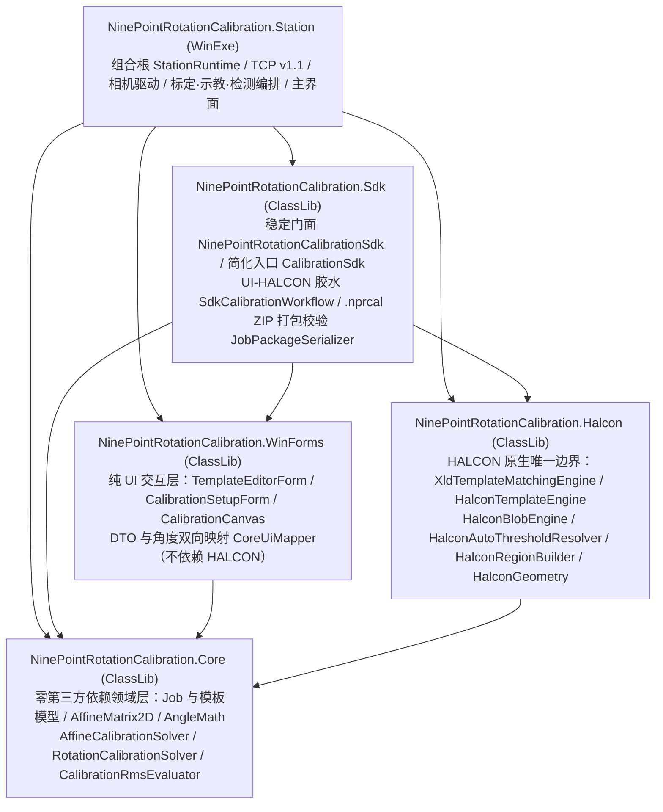
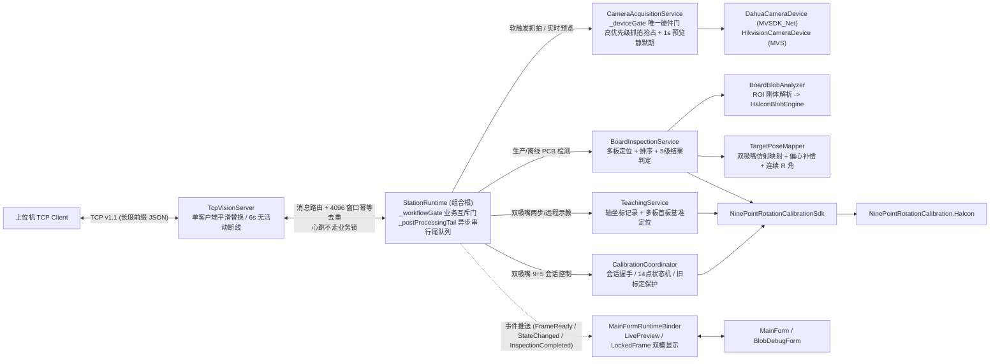
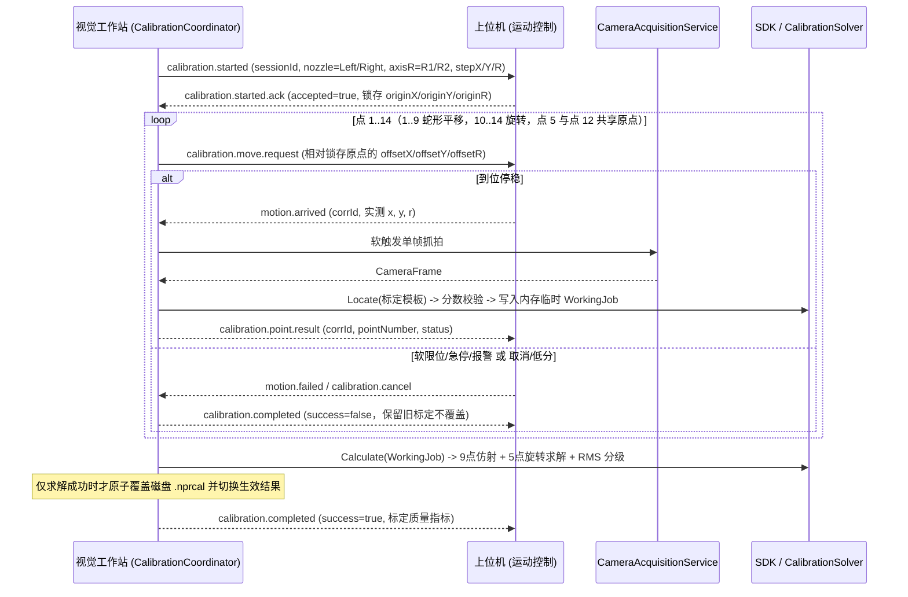
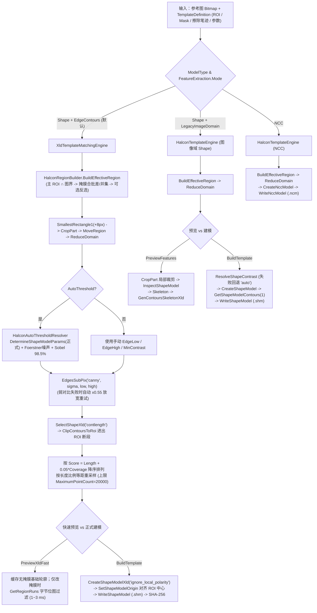
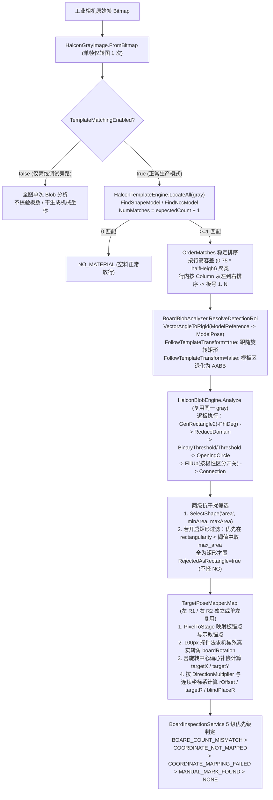
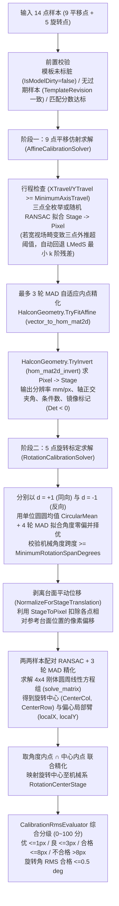

# ZM910A 九点旋转标定与独立视觉工作站——系统架构、视觉链路与核心易混点说明文档

> **代码基线**：[`Aoxuan666/NinePointRotationCalibration`](https://github.com/Aoxuan666/NinePointRotationCalibration)  
> **同步分支与提交**：`ct-optimization-board-rotation` @ `8569de0`（基于最新拉取代码分析，领先 `main` 34 个提交）  
> **技术栈**：`.NET Framework 4.7.2` · `HALCON 19.11` (`halcondotnet.dll`) · `WinForms` · `TCP v1.1 (JSON)` · 大华 `MVSDK_Net` / 海康 `MVS`

---

## 目录

- [1. 项目整体流程与大模块间的联系](#1-项目整体流程与大模块间的联系)
  - [1.1 系统物理拓扑与进程边界](#11-系统物理拓扑与进程边界)
  - [1.2 五层工程结构与依赖关系](#12-五层工程结构与依赖关系)
  - [1.3 站级运行时的模块编排与协作机制](#13-站级运行时的模块编排与协作机制)
  - [1.4 四大端到端核心主流程](#14-四大端到端核心主流程)
- [2. 视觉模块设计思路、核心 HALCON 算子与完整视觉链路](#2-视觉模块设计思路核心-halcon-算子与完整视觉链路)
  - [2.1 视觉模块六大核心设计思路](#21-视觉模块六大核心设计思路)
  - [2.2 核心 HALCON 算子全景清单（源码级审计）](#22-核心-halcon-算子全景清单源码级审计)
  - [2.3 视觉链路一：模板特征预览与建模链路](#23-视觉链路一模板特征预览与建模链路)
  - [2.4 视觉链路二：单帧生产检测与双吸嘴坐标映射链路](#24-视觉链路二单帧生产检测与双吸嘴坐标映射链路)
  - [2.5 视觉链路三：9+5 手眼标定与旋转中心求解链路](#25-视觉链路三95-手眼标定与旋转中心求解链路)
- [3. 主要模块易混点整理（避坑速查）](#3-主要模块易混点整理避坑速查)
  - [3.1 易混点速查总表](#31-易混点速查总表)
  - [3.2 逐项深度解析](#32-逐项深度解析)
- [4. 关键持久化文件与运行目录说明](#4-关键持久化文件与运行目录说明)

---

## 1. 项目整体流程与大模块间的联系

### 1.1 系统物理拓扑与进程边界

本项目面向 **ZM910A PCB 移栽龙门设备**（**共用 X/Y 轴 + 独立左吸嘴 `R1` / 右吸嘴 `R2`**），采用“**视觉工作站与上位机完全进程解耦**”架构：

| 角色 | 通讯身份 | 独占资源 | 核心职责 |
| :--- | :--- | :--- | :--- |
| **视觉工作站** (`Station`) | TCP Server（默认 `0.0.0.0:9100`，单活动客户端） | 工业相机硬件、HALCON 引擎、本地配方与 `.nprcal` 文件 | 相机连接/软触发/预览、模板建模、左/右吸嘴独立 9+5 标定求解、两步示教、多板定位 + 逐板 Blob 坏板标记检测、双吸嘴机械坐标与连续 R 角映射、状态推送 |
| **上位机** (`Host`) | TCP Client | 运动控制卡（X/Y/R1/R2）、安全互锁、IO 与工艺机台 | 建连与 2 s 周期心跳、标定原点锁存、轴移动与停稳反馈、软限位/急停/伺服报警拦截、多圈 R 轴行程校验、实际取放料与 NG 处理 |

> **核心隔离原则**：视觉程序绝不直接调用运动卡；上位机绝不直接操作相机。双方仅通过带 `messageId` / `correlationId` 的 **TCP v1.1 长度前缀 JSON 协议**（`[4B 大端长度] + [UTF-8 JSON]`）通信。

### 1.2 五层工程结构与依赖关系

解决方案 `NinePointRotationCalibration.sln` 由 5 个核心生产工程构成，严格单向分层、零循环依赖：

| 工程 | 外部依赖 | 核心职责与设计边界 |
| :--- | :--- | :--- |
| **`Core`** | 无 | 定义所有核心 DTO（`CalibrationJob`、`TemplateDefinition`、`ImagePose`、`MachinePose`、`AffineMatrix2D`）、9+5 鲁棒标定求解器、RMS 分级评分器以及抽象几何接口 `ICalibrationGeometryBackend`。 |
| **`Halcon`** | `halcondotnet` | 隔离全部 HALCON 算子与原生句柄生命周期，向外只暴露托管结果对象；同时实现 `ICalibrationGeometryBackend` 供 `Core` 求解器调用底层矩阵算子。 |
| **`WinForms`** | 仅 `Core` | 纯 UI 控件与模板/标定弹窗。通过 `ITemplateEditorService`、`ICalibrationWorkflow` 接口反转依赖，**不直接引用 HALCON**，保证界面层可独立维护和设计器预览。 |
| **`Sdk`** | `Core` + `Halcon` + `WinForms` | 将 `XldTemplateMatchingEngine`、`HalconCalibrationGeometryBackend` 和 `WinForms` 窗体装配成稳定门面；封装 `.nprcal`（ZIP：`job.json` + `model.bin` + `reference-image.png`）的 SHA-256 完整性校验与原子落盘。 |
| **`Station`** | 上述全部 + 大华/海康 SDK | 独立工作站宿主。以 `StationRuntime` 为组合根串联 TCP、相机、标定、示教、检测五大服务，并通过 `MainFormRuntimeBinder` 与纯设计器窗体 `MainForm` 绑定。 |

### 1.3 站级运行时的模块编排与协作机制

在 `Station` 内部，`StationRuntime` 扮演**唯一组合根与协调中枢**，其内部大模块之间的连接与并发门控如下：

**四大关键模块间联络机制**：

1. **四层串行门控（避免硬件竞态、HALCON 线程冲突与生产 CT 抖动）**：
   - `StationRuntime._workflowGate`：互斥所有排他性视觉流程（生产检测、标定、示教、导入配置）；**`system.heartbeat` / `system.hello` 不走此锁**，确保运动等待或检测期间心跳 `< 10 ms` 直回，不触发 `BUSY` 或假断线。
   - `CameraAcquisitionService._deviceGate`：相机硬件唯一门控，消除大华/海康 SDK 共享帧缓冲并发竞态；配合 `_priorityCapturesPending` 计数与 **1000 ms 预览静默期**，确保生产/标定软触发优先抢占相机，不被后台预览曝光阻塞。
   - `HalconTemplateEngine._syncRoot`：保护非线程安全的原生 `HShapeModel` / `HNCCModel` 句柄。
   - `StationRuntime._postProcessingTail`：生产检测算完后**先释放 `_workflowGate` 并发送 TCP `inspection.result`**，再把 UI 图像刷新与存图归档挂到后台串行队列执行，实现**显示/归档零占用生产 CT**。
2. **数据与持久化隔离**：
   - 运行时通过 `DeepClone()` 向各子服务传递只读快照；磁盘写入统一采用**临时文件 + `File.Replace` 原子替换**（`AtomicJsonStore` 与 `JobPackageSerializer`），防止断电或异常导致配置文件半写损坏。
3. **UI 与运行时解耦**：
   - `MainForm` 保留无参构造和独立 `.Designer.cs`，不持有任何业务/相机/HALCON 引用；`MainFormRuntimeBinder` 在外部完成事件订阅与视图更新，并通过 `DisplayGeneration` 隔离实时预览帧与锁定调试帧。
4. **三大独立运行开关协同**：
   - `CameraEnabled`、`CalibrationEnabled`、`InspectionEnabled` 相互独立持久化，任意状态变化由 `StationRuntime` 去重比对 `SystemStatusSnapshot` 后主动向上位机推送 `system.status`。

### 1.4 四大端到端核心主流程

#### 流程 A：模板建模与 `.nprcal` 持久化流程

1. 操作员在主界面选择编辑 **标定模板（左/右）** 或 **定位模板**，通过 `StationRuntime` 调用 `NinePointRotationCalibrationSdk.OpenTemplateDialog(...)`（定位模板传 `enableDetectionRoi: true`）。
2. 若 `.nprcal` 已持久化原始参考底图（`reference-image.png`），编辑器自动优先加载原底图以便在原坐标系上复现和微调 ROI/掩膜，同时允许切换至当前实时画面。
3. 在 `TemplateEditorForm` 内调整 ROI、掩膜、擦除笔刷、自适应/手动阈值时，经 `SdkCalibrationWorkflow`（`CoreUiMapper` + `HalconGrayImage` 缓存）异步调用 `PreviewFeatures` 快速刷新边缘轮廓预览。
4. 点击“创建模型”调用 `BuildTemplate` 生成 HALCON `.shm`/`.ncm` 二进制与 SHA-256 哈希；确认后由 `JobPackageSerializer` 打包为 `.nprcal` 原子落盘并刷新内存快照。

#### 流程 B：双吸嘴独立 9+5（14 点）标定流程

#### 流程 C：双吸嘴两步示教流程

因为吸嘴移动到 PCB 示教位时会**物理遮挡相机视野**，系统将示教拆分为互不干扰的两步（支持先记轴后定位，或先定位后记轴）：

1. **记录机械轴坐标（不拍照）**：
   - 方式一（视觉发起）：操作员将左/右吸嘴对准基准板并点击“记录轴坐标” → `StationRuntime` 发送 `teaching.pose.request` → 上位机实时返回 `teaching.pose.response(x, y, r)` → `TeachingService.RecordMachinePoseAsync` 保存为半完成态（`HasMachinePose=true`）。
   - 方式二（上位机发起）：上位机发 `teaching.submit`（默认 `captureImage=false`），同样仅记轴坐标不拍照。
2. **移轴后模板匹配定位**：
   - 吸嘴移出视野后，视觉点击“模板匹配定位” → `TeachingService.LocateImagePoseAsync` 软触发拍照 → 使用定位模板执行**全量多目标匹配（`NumMatches=0`）并经 `BoardInspectionService.OrderMatches` 稳定排序取第 1 号板**（防止多板视野下因帧间分数微弱波动导致左右吸嘴锁到不同 PCB 上！）→ 与已存轴坐标自动合并为 `IsValid=true` 并原子持久化至 `teaching.json`。

#### 流程 D：生产实时检测与双吸嘴坐标输出流程

```mermaid
flowchart LR
    Trig["上位机 inspection.trigger\n(currentRLeft, currentRRight, expectedCount)"] --> Gate["StationRuntime 入口校验\n使能开关 / 相机状态 / 去重 / _workflowGate"]
    Gate --> Grab["CameraAcquisitionService\n高优先级软触发采图 (<=2000ms)"]
    Grab --> Conv["单次灰度转换\nHalconGrayImage.FromBitmap"]
    Conv --> Match["定位模板多目标匹配\nLocateAll (NumMatches = expectedCount + 1)"]
    Match -->|"0 目标"| NoMat["返回 NO_MATERIAL\n(Success=true, Pass=true)"]
    Match -->|">=1 目标"| Sort["OrderMatches 行容差聚类\n从上到下、从左到右稳定编号"]
    Sort --> Roi["BoardBlobAnalyzer\n逐板刚体变换解析 DetectionRoi"]
    Roi --> Blob["HalconBlobEngine\n逐 ROI 阈值/形态学/填洞/面积&矩形度过滤"]
    Blob --> Map["TargetPoseMapper\n左/右双 R 轴独立仿射映射 + 偏心补偿"]
    Map --> Judge["5 级优先级结果判定\n释放 _workflowGate -> 立即发送 inspection.result"]
    Judge -.->|"后台串行尾队列 (不占 CT)"| Post["UI 刷新与图像归档"]
```

---

## 2. 视觉模块设计思路、核心 HALCON 算子与完整视觉链路

### 2.1 视觉模块六大核心设计思路

1. **双引擎策略与运行时归一（Decorator / Delegation 模式）**
   - `NinePointRotationCalibrationSdk` 默认装配 `XldTemplateMatchingEngine`，它内部持有 `HalconTemplateEngine`（传统图像域 Shape / NCC 引擎）。
   - **建模与预览阶段**按 `TemplateModelType` 和 `ShapeFeatureExtractionMode` 分流：
     - `Shape + EdgeContours`（默认新模式）：由 `XldTemplateMatchingEngine` 提取亚像素 Canny XLD 轮廓，经 ROI 裁剪、评分排序、按长度比例重采样后调用 `create_shape_model_xld` 建模，强制采用 `ignore_local_polarity` 适应板面明暗反光变化。
     - `Shape + LegacyImageDomain` / `Ncc`：直接委托 `HalconTemplateEngine` 执行传统图像域 `create_shape_model` 或 `create_ncc_model`。
   - **运行时定位阶段**（`Locate` / `LocateAll`）全部统一委托给 `HalconTemplateEngine`，因为 XLD 建模产出的 `.shm` 与传统 Shape 模型在 `find_shape_model` 层完全一致，消除了重复维护两套匹配路径的开销。

2. **单帧零重复转图与多级灰度图复用（`HalconGrayImage`）**
   - `HalconGrayImage` 封装一次性生成的单通道 8-bit `HImage` 与全局递增 `CacheId`，支持通过 `Share()`（底层 `copy_obj(1, 1)` 浅拷贝引用）在多线程/多阶段共享只读像素内存。
   - **生产检测**：整帧在 `BoardInspectionService` 中只转换一次 `HalconGrayImage`，通过可选扩展接口 `IGrayImageTemplateMatchingEngine.LocateAll(HalconGrayImage, ...)` 直通模板匹配，随后原封不动传给 `HalconBlobEngine.Analyze(HalconGrayImage, ...)`，彻底消除单帧二次 `LockBits` 与拷贝。
   - **交互调试与模板编辑**：主窗体锁定帧使用 `LockedFrameGrayCache`、`BlobDebugForm` 缓存当前图灰度句柄、`SdkCalibrationWorkflow` 通过 WeakReference + 16×16 网格 FNV-1a 像素签名缓存灰度图，使操作员反复拖动阈值滑块时达到 **0 ms 转图开销**。

3. **面向 20MP 工业相机的四项核心提速设计**
   - **ROI 外接框局部裁剪**：在 `PreviewFeatures` 和 XLD 建模前，先对有效区域求 `smallest_rectangle1` 外扩 8 px，执行 `crop_part` + `move_region` + `reduce_domain`，仅在局部小图上跑 Canny / 噪声估计 / `inspect_shape_model`，提取后再偏移回原图坐标。
   - **未掩膜基础轮廓缓存 + 行程位图过滤**：`XldTemplateMatchingEngine.PreviewXldFast` 按 `(ImageCacheId, ROI 几何, 边缘参数)` 缓存无掩膜基础 Canny 轮廓。当用户仅涂抹擦除/恢复掩膜时，**完全跳过阈值分析与 Canny**，改用 `get_region_runs` 在内存中构建局部 `byte[]` 掩膜进行向量化点过滤，单次预览仅需 **1~3 ms**。
   - **同极性掩膜合批 + 同半径画笔分组膨胀**：`HalconRegionBuilder.ApplyMaskBatch` 将连续同操作（连续擦除或连续恢复）的掩膜合并处理，并将同半径画笔折线收集后一次性 `gen_region_line` → `union1` → 单次 `dilation_circle`，把 N 笔串行膨胀耗时降低一个数量级。
   - **二值预览图行程直写**：`HalconBlobEngine.RenderBinary` 直接读取 `get_region_runs` 行程数组并通过 `Marshal.Copy` 写入 `Format8bppIndexed` 位图，省去临时 `HImage` 构造、`paint_region` 与千万级字节中间数组分配。

4. **多源融合自适应阈值与渐进兜底（`HalconAutoThresholdResolver`）**
   - 自动融合三路信号计算 Canny 双阈值和 Shape 滞后对比度：`determine_shape_model_params`（仅正式建模调用，预览跳过以保流畅）+ `estimate_noise("foerstner", 20.0)` 噪声底噪 + `sobel_amp("sum_abs", 3)` + `gray_histo` 98.5% 强边缘梯度分位。
   - 若初算阈值在弱对比/细丝印场景下未抓到足够轮廓：XLD 路径自动将低/高阈值 **×0.55** 放宽重试并回写实测阈值；图像域 Shape 路径自动回退 HALCON 原生 `"auto"` 对比度。

5. **模板句柄热缓存与双层超时保护**
   - `HalconTemplateEngine.EnsureModelLoaded` 在生产高频匹配时先比对 `(ModelType:ModelHash, ModelData.Length)`，命中即直接复用内存中的原生 `HShapeModel`/`HNCCModel` 句柄，省去每帧重复 SHA-256 与临时文件磁盘 I/O。
   - 匹配前尝试 `set_shape_model_param("timeout", ms)` / `set_ncc_model_param("timeout", ms)`，同时在外层保留 `Stopwatch` 软超时兜底，兼容不同 HALCON 19.11 构建版本。

6. **防御性边界处理（消除 HALCON 经典隐性 Bug）**
   - `HalconRegionBuilder` 静态构造函数显式调用 `HSystem.SetSystem("clip_region", "false")`，避免进程刚启动未加载大图前 HALCON 默认按 `128×128` 静默截断 ROI/掩膜。
   - `HalconImageConverter.FromInterleaved` 检测 `data.Stride != width * bytesPerPixel`：当 24bpp 图像宽度非 4 的倍数存在行填充时，拒绝走 `gen_image_interleaved`（HALCON 按紧致步长读取会导致斜切错位），自动回退 32bpp 路径安全转换。
   - `HalconBlobEngine.SelectSingleLargest` 在 `select_shape_std("max_area")` 后强制 `select_obj(1)`，避免两个连通域面积完全相等时标量 `area_center` 抛出多对象异常。
   - `HalconGeometry.TrySolveLinear` 在 `finally` 块中严格调用 `clear_matrix` 释放三个矩阵句柄，防止长跑内存泄漏。

---

### 2.2 核心 HALCON 算子全景清单（源码级审计）

以下为当前最新代码 `NinePointRotationCalibration.Halcon` 中实际调用的全部 HALCON 算子分类清单：

| 功能阶段 | HALCON 算子（对应 C# 方法） | 所在文件 | 关键参数与作用说明 |
| :--- | :--- | :--- | :--- |
| **一、图像桥接与转换** | `gen_image1` / `crop_part` | `HalconImageConverter.cs` | 8bpp 灰度图零重绘直转 `HImage`；存在行对齐填充时 `crop_part` 裁剪至精确宽度 |
| | `gen_image_interleaved` / `rgb1_to_gray` | `HalconImageConverter.cs` | 24bpp (`"bgr"`) / 32bpp (`"bgrx"`) 交错像素直转并立即灰度化生成独立内存 |
| | `copy_obj` | `HalconGrayImage.cs` | `Share()` 共享只读像素引用，实现单帧零重复转图 |
| | `count_channels` / `get_image_pointer1` | `HalconImageConverter.cs` | 单通道 HALCON 灰度图反向回写为 8bpp 托管 `Bitmap` |
| **二、ROI 与掩膜区域构建** | `set_system("clip_region", "false")` | `HalconRegionBuilder.cs` | 禁用默认 128×128 区域裁剪，全部区域显式与 `imageBounds` 求交 |
| | `gen_rectangle1` / `gen_rectangle2` / `gen_circle` / `gen_region_polygon_filled` | `HalconRegionBuilder.cs` | 将 5 种 `RegionKind`（轴对齐矩形、旋转矩形、圆、多边形、自由区）构造为 `HRegion` |
| | `gen_region_line` / `union1` / `dilation_circle` | `HalconRegionBuilder.cs` | 批量构造同半径画笔折线中心并一次性圆形膨胀，大幅加速多笔擦除 |
| | `concat_obj` / `union2` / `intersection` / `difference` | `HalconRegionBuilder.cs` | 按序合批执行掩膜排除、恢复（限定在主 ROI 内）与掩膜反选 |
| | `smallest_rectangle1` / `move_region` / `area_center` | `HalconRegionBuilder.cs` | 计算 ROI 外接裁剪框、平移至局部坐标、校验有效面积非空与求质心 |
| | `boundary("inner")` / `connection` / `gen_contour_region_xld("center")` | `HalconRegionBuilder.cs` | 提取含孔洞/分离区域的有序边界轮廓用于界面叠加与 NCC 轮廓显示 |
| **三、自适应阈值估计** | `determine_shape_model_params` | `HalconAutoThresholdResolver.cs` | 正式建模时自动估计 `contrast_low`、`contrast_high`、`min_contrast` |
| | `estimate_noise("foerstner", 20.0)` | `HalconAutoThresholdResolver.cs` | 估计 ROI 图像噪声底噪，防止基板纹理产生海量碎边 |
| | `get_domain` / `sobel_amp("sum_abs", 3)` / `gray_histo` | `HalconAutoThresholdResolver.cs` | 统计有效域内 Sobel 梯度直方图 98.5% 分位，与噪声底噪共同锁定上下限 |
| **四、模板提取、建模与持久化** | `reduce_domain` | `XldTemplateMatchingEngine.cs` `HalconTemplateEngine.cs` | 将灰度图像域限定到模板有效区域或搜索区域 |
| | `edges_sub_pix("canny", sigma, low, high)` | `XldTemplateMatchingEngine.cs` | XLD 模式核心算子：亚像素级 Canny 边缘轮廓提取 |
| | `select_shape_xld("contlength", "and", minLen, 1e30)` | `XldTemplateMatchingEngine.cs` | 过滤过短边缘碎段，保留主特征轮廓 |
| | `create_shape_model_xld` / `set_shape_model_origin` | `XldTemplateMatchingEngine.cs` | 由有序筛选 XLD 轮廓创建形状模板（`ignore_local_polarity`），并将原点由外接框中心校准到模板 ROI 中心 |
| | `inspect_shape_model` / `skeleton` / `gen_contours_skeleton_xld("filter")` | `HalconTemplateEngine.cs` | 传统图像域 Shape 模式的快速特征预览（跳过完整建模与写盘） |
| | `create_shape_model` / `get_shape_model_contours` | `HalconTemplateEngine.cs` | 传统图像域 Shape 建模及提取模板第 1 层金字塔相对轮廓 |
| | `create_ncc_model` | `HalconTemplateEngine.cs` | 低纹理/灰度主导目标的归一化互相关（NCC）建模 |
| | `write_shape_model` / `read_shape_model` `write_ncc_model` / `read_ncc_model` | `HalconTemplateEngine.cs` `XldTemplateMatchingEngine.cs` | 经 `HalconModelFile` 临时文件中转，与 `.nprcal` 中 `model.bin` 互转 |
| **五、运行时模板匹配** | `set_shape_model_param("timeout")` / `set_ncc_model_param("timeout")` | `HalconTemplateEngine.cs` | 配置 HALCON 原生匹配超时上限（不开放时由外层软超时兜底） |
| | `find_shape_model` / `find_ncc_model` | `HalconTemplateEngine.cs` | 多目标模板匹配（Shape 默认亚像素 `least_squares`，NCC 默认 `"true"`） |
| | `select_obj` / `get_contour_xld` | `HalconContourConverter.cs` | 逐段提取 XLD 坐标点并刚体变换到目标匹配位姿 |
| **六、逐板 Blob 缺陷分析** | `gen_rectangle2` / `reduce_domain` | `HalconBlobEngine.cs` | 构造单板旋转检测 ROI（角度取反转为逆时针弧度）并裁剪处理域 |
| | `binary_threshold("max_separability", "dark"/"light")` / `threshold` | `HalconBlobEngine.cs` | 自动 Otsu 最大类间方差分割或固定灰度阈值分割，支持黑底白叉 / 白底黑叉双极性 |
| | `opening_circle` / `fill_up` | `HalconBlobEngine.cs` | 圆形开运算滤除细小亮噪点 + 空洞填充（亮/暗目标开关分离） |
| | `connection` / `select_shape("area")` / `select_shape("rectangularity")` | `HalconBlobEngine.cs` | 连通域拆解 + 面积区间筛选 + 矩形度过滤（剔除矩形标签干扰） |
| | `select_shape_std("max_area", 70.0)` / `select_obj(1)` | `HalconBlobEngine.cs` | 选取面积最大的单连通目标，强制取第 1 个防止等面积多对象崩溃 |
| | `area_center` / `rectangularity` / `gen_contour_region_xld("border")` / `get_region_runs` | `HalconBlobEngine.cs` | 输出缺陷质心、面积、矩形度、闭合绘制轮廓及快速 8bpp 二值图 |
| **七、二维标定与刚体几何** | `vector_to_hom_mat2d` / `hom_mat2d_invert` / `affine_trans_point_2d` | `HalconGeometry.cs` | 9 点平移仿射矩阵拟合（`Stage -> Pixel`）、求逆（`Pixel -> Stage`）与点/向量变换 |
| | `vector_angle_to_rigid` | `HalconGeometry.cs` | 按匹配位姿刚体变换检测 ROI 中心（`ModelReference -> ModelPose`） |
| | `create_matrix` / `solve_matrix("general", 1e-12)` / `get_full_matrix` / `clear_matrix` | `HalconGeometry.cs` | 5 点旋转标定 4×4 线性正规方程求解（旋转中心 + 局部偏心臂） |

---

### 2.3 视觉链路一：模板特征预览与建模链路

**XLD 建模链路中的 3 个精妙细节**：
1. **进出 ROI 断段防伪边（`ClipContoursToRoi`）**：Canny 边缘若在 ROI 边界处离开又重新进入，算法强制拆分为多段独立轮廓，避免将出入口两点直接连成一条现实中不存在的“伪直线”写入模板。
2. **模板原点强制校准（`SetModelOrigin`）**：`create_shape_model_xld` 默认将输入轮廓外接框的几何中心设为 `(0, 0)`，而非用户框选的 ROI 中心。当存在局部掩膜擦除时外接框中心会偏移，因此代码显式计算 `targetCenter - bboxCenter` 并调用 `set_shape_model_origin` 将模型原点锁定回模板 ROI 中心（多边形/自由区取有效域质心）。
3. **预览坐标系一致性**：预览直接返回图像坐标下的采样轮廓；而运行时匹配则使用 `get_shape_model_contours(1)` 返回的相对轮廓按 `(modelRow, modelColumn, modelAngle)` 实时刚体变换叠加显示。

---

### 2.4 视觉链路二：单帧生产检测与双吸嘴坐标映射链路

**目标位姿映射数学链路（`TargetPoseMapper.AddMappedPose`）**：

设某侧吸嘴（左或右）的标定仿射矩阵为 $T_{\text{p}\to\text{s}}$（`PixelToStage`），旋转中心偏心向量为：
$$\vec{e} = C_{\text{rot,stage}} - P_{\text{ref,stage}}$$
示教时刻的机械位姿为 $(M_x, M_y, M_r)$、图像锚点为 $A_{\text{teach}}$；当前检测到板的图像锚点为 $A_{\text{cur}}$。则：

1. **机械系下的真实板转角 $\Delta\theta_{\text{stage}}$**：在图像系沿模板朝向构造 100 px 探针点 $A + (100\cos\alpha,\ -100\sin\alpha)$，经 $T_{\text{p}\to\text{s}}$ 映射到机械台面后取 $\operatorname{atan2}$ 差值（自动吸收镜像轴与行向下坐标系差异）。
2. **含旋转中心偏心的刚性力臂与目标 XY**：
   $$\vec{a} = \big(M_{\text{teach}} - T_{\text{p}\to\text{s}}(A_{\text{teach}})\big) + \vec{e}$$
   $$P_{\text{target}} = T_{\text{p}\to\text{s}}(A_{\text{cur}}) - \vec{e} + R(\Delta\theta_{\text{stage}})\,\vec{a}$$
3. **连续坐标系 R 轴目标角（不做 `[-180, 180]` 或 `[0, 360]` 截断）**：
   $$\theta_{\text{pick}} = M_r + d \cdot \operatorname{Normalize}(\alpha_{\text{cur}} - \alpha_{\text{teach}}),\quad d \in \{+1, -1\}$$
   $$\Delta R = \operatorname{Normalize}(\theta_{\text{pick}} - R_{\text{cur}}),\quad R_{\text{target}} = R_{\text{pick}} = R_{\text{cur}} + \Delta R,\quad R_{\text{blindPlace}} = M_r$$

---

### 2.5 视觉链路三：9+5 手眼标定与旋转中心求解链路

标定求解由 `Core` 主导算法编排、`HalconCalibrationGeometryBackend` 执行底层矩阵算子，分为严格串行的两大阶段：

**刚体圆周旋转中心方程（`FitRigidCenter`）**：

在图像坐标系（Column 向右、Row 向下，HALCON 角度 $\phi = d \cdot \theta_{\text{machine}}$ 逆时针为正）中，扣除台面平动后的归一化坐标满足关于未知量 $[C_{\text{col}}, C_{\text{row}}, l_x, l_y]^T$ 的线性方程：
$$\begin{bmatrix} c_{\text{norm}} \\ r_{\text{norm}} \end{bmatrix} = \begin{bmatrix} C_{\text{col}} \\ C_{\text{row}} \end{bmatrix} + \begin{bmatrix} \cos\phi & \sin\phi \\ -\sin\phi & \cos\phi \end{bmatrix} \begin{bmatrix} l_x \\ l_y \end{bmatrix}$$
每组旋转样本贡献 2 条线性方程，任意 2 个不同角度样本即可唯一构成 4 元线性初值作为 RANSAC 种子，最终对全部联合内点经 `create_matrix` + `solve_matrix("general", 1e-12)` 加权最小二乘一次性精确求解，避免了非线性迭代的初值敏感问题。

---

## 3. 主要模块易混点整理（避坑速查）

> 本章略去常规业务胶水代码细节，聚焦于在二次开发、现场联调和算法维护中**最容易理解偏差或引入隐蔽 Bug 的 10 个核心易混点**。

### 3.1 易混点速查总表

| 编号 | 易混概念 / 机制 | 常见误解 | 代码中的真实实现 |
| :---: | :--- | :--- | :--- |
| **1** | **HALCON 角度 vs UI/Blob 角度** | 全工程角度正方向一致 | HALCON `PhiRadians`/`ModelPose.AngleDegrees` **逆时针为正**；WinForms 画布/`DetectionRoi.PhiDegrees`/`HalconBlobRegion.PhiDegrees` **顺时针为正**，边界处多次显式取反 |
| **2** | **`Anchor` vs `ModelPose` vs `DomainCenter`** | `Match.Row/Column` 就是模板中心 | `Match.Row/Column` 是**用户可拖动的 `ReferenceAnchor`**；`ModelPose` 才是 HALCON 匹配原点；检测 ROI 变换基于 `ModelReference -> ModelPose` |
| **3** | **三种 ROI 与 `FollowTemplateTransform`** | 关闭跟随旋转后变成整图全局 ROI | `FollowTemplateTransform=false` 只是**忽略 `DetectionRoi`**、把各板 `TemplateRoi` 退化为独立 AABB；真正整图单次 Blob 是 `TemplateMatchingEnabled=false` |
| **4** | **标定模板 vs 定位模板 & `Revision`/`Dirty`** | 两者共用一个模板，或改了匹配分数就要重采 14 点 | 标定模板（`calibration*.nprcal`）与定位模板（`positioning.nprcal`）完全独立；`IsModelDirty` 或 `TemplateRevision` 变更会使旧样本成 `StaleSamples` 拒算 |
| **5** | **`StageToPixel` vs `PixelToStage`** | 9 点标定直接拟合像素到机械矩阵 | 求解器**先在像素空间拟合 `Stage -> Pixel`**（保证 RANSAC/MAD 像素残差有物理量纲意义），再 `hom_mat2d_invert` 求逆得 `Pixel -> Stage` |
| **6** | **双吸嘴标定与“单左复用”/单侧示教** | 必须左右都标定且都示教完才能出坐标 | 仅标定左侧（或仅右侧）时系统**自动复用该侧标定供双吸嘴使用**；单侧完成示教即刻输出该侧 `targets[]` |
| **7** | **9+5 偏移基准与会话旧标定保护** | `move.request` 是相对上一点的步进增量；中途失败会清空旧标定 | `offsetX/Y/R` **永远相对 `started.ack` 锁存原点**（点 5 与点 12 共享原点）；会话只写内存副本，任意异常中止**绝不覆盖**旧标定 |
| **8** | **连续 R 轴角 vs 归一化 & 两套角度算法** | `targetR` 应归一化到 `[-180, 180]`，且直接用板角差算 XY 力臂 | `targetR` **严禁归一化**（保持与 `currentR` 同连续多圈坐标系）；XY 力臂转角用探针法 `StageAngleDegrees` 自动处理镜像，R 轴角用标定 `DirectionMultiplier` |
| **9** | **Blob 过滤顺序与 `RejectedAsRectangle`** | 先找最大连通域再判面积/矩形度；矩形拒识会报 NG | **先滤面积，再优先选非矩形最大连通域**（防大矩形标签吞掉小叉号）；`RejectedAsRectangle=true` 时 `HasFinding=true` 供调试展示，但 `HasManualMark=false` 不报 NG |
| **10** | **空料 `NO_MATERIAL`、5 级结果判定与图像来源** | 找不到板就是 NG 报错；生产触发可复测当前显示图 | **0 块板是正常空料（`Success=true, Pass=true`）**；`MANUAL_MARK_FOUND` 时 `Success=true, Pass=false`；生产 TCP **严禁复用 UI 离线图** |

---

### 3.2 逐项深度解析

#### 易混点 1：多套坐标系与角度正方向的“反复取反”

在行向下（Row ↓、Column →）的图像空间中，存在两种截然相反的旋转角符号约定：

| 数据结构 / 算子 | 单位 | 正方向（俯视图像） | 备注 |
| :--- | :--- | :--- | :--- |
| `RegionDefinition.PhiRadians` / `GenRectangle2` | 弧度 | **逆时针为正** | HALCON 原生约定 |
| `ImagePose.AngleDegrees` / `TemplateMatchResult.AngleDegrees` | 度 | **逆时针为正** | 来自 `find_shape_model` / `find_ncc_model` |
| WinForms `RotatedRectangle.AngleDegrees` / GDI+ 绘制 | 度 | **顺时针为正** | `CoreUiMapper` 在 UI ↔ Core 互转时显式取反 |
| `DetectionRoi.PhiDegrees` / `HalconBlobRegion.PhiDegrees` | 度 | **顺时针为正** | `BoardBlobAnalyzer` 生成时取反；`HalconBlobEngine` 调 `GenRectangle2` 时再取反还原 |
| `HalconGeometry.TransformRigid` 内部 `VectorAngleToRigid` | 弧度 | 内部取反 | 因参数按 `(Column, Row)` 传入，坐标手性与 HALCON 默认 `(Row, Column)` 相反，必须传 `-Angle` |

> **排错口诀**：如果发现旋转矩形 ROI 跟随板件时“往反方向转”，第一时间检查 `CoreUiMapper`、`BoardBlobAnalyzer.TransformRegion`、`HalconBlobEngine` 和 `HalconGeometry.TransformRigid` 这 4 处符号是否成对匹配。

#### 易混点 2：`DomainCenter`、`ModelReference`、`ReferenceAnchor` 与匹配输出

模板内部维护 3 个容易混淆的坐标点：

- **`DomainCenter`**：模板有效区域（主 ROI 扣除全部掩膜/笔迹后）的像素质心。
- **`ModelReference`**：HALCON 模板模型原点 `(0, 0)` 在参考图中的对应位置。
  - 图像域 Shape / NCC 模式：`ModelReference = DomainCenter`。
  - XLD 模式（矩形/圆 ROI）：`ModelReference = TemplateRoi 几何中心`（通过 `SetShapeModelOrigin` 校准）；多边形/自由区取 `DomainCenter`。
- **`ReferenceAnchor`**：用户可在模板编辑器中手动拖拽并锁定（`IsReferenceAnchorLocked`）的业务输出基准点；首次未初始化时默认等于 `ModelReference`。

**最容易写错的点**：
- `TemplateMatchResult.Row` / `.Column` 实际读写的是 **`Anchor`**（即 `ReferenceAnchor` 经匹配位姿刚体变换后的位置），而 `TemplateMatchResult.ModelPose` 才是 HALCON 匹配的模板原点！
- 标定采点与 `TargetPoseMapper` 统一使用 `Anchor`；而 `BoardBlobAnalyzer.TransformRegion` 变换检测 ROI 使用的是 `ModelReference -> ModelPose`，确保用户随意拖动锚点不会把检测框拖歪。

#### 易混点 3：三种 ROI 职责边界与 `FollowTemplateTransform` / `TemplateMatchingEnabled`

- **`TemplateRoi`**：决定哪些像素/边缘用来构建匹配模板。
- **`SearchRegion`**：决定匹配时在图像的哪个范围内搜索（为空时默认整图）。
- **`DetectionRoi`**：决定在每块定位到的 PCB 上去哪里做 Blob 找白叉/黑叉。**它的几何只保存在定位模板 `positioning.nprcal` 中，`detection-profile.json` 绝不保存 ROI 坐标！**

两个检测开关的真实含义对比：

| `TemplateMatchingEnabled` | `FollowTemplateTransform` | 实际行为 |
| :---: | :---: | :--- |
| `true`（生产默认） | `true`（推荐） | 定位 N 块板 → 优先取 `DetectionRoi`（缺失退回 `TemplateRoi`）随每块板刚体旋转平移 → 得到 N 个旋转矩形检测区 |
| `true` | `false` | 定位 N 块板 → **忽略 `DetectionRoi`**，改取 `TemplateRoi` 变换后转成轴对齐外接矩形（AABB）→ 仍有 N 个独立检测区，**不是全局 ROI** |
| `false`（仅离线调试） | 任意 | 完全跳过模板定位，对整幅图执行 1 次全图 Blob 分析，不校验板数、不生成机械目标（`Valid=false`） |

#### 易混点 4：标定模板 vs 定位模板，以及 `Template.Revision` 防呆

- **独立双轨**：标定模板（左 `calibration.nprcal`、右 `calibration-right.nprcal`）只认标定特征点，承载 14 点标定样本与求解配置；定位模板（`positioning.nprcal`）只认生产 PCB，承载 `DetectionRoi`。两者不要混用。
- **防过期样本机制**：每条 `CalibrationSample` 都记录采集时的 `TemplateRevision`。一旦重新修改 ROI/掩膜/建模参数导致模板变脏（`IsModelDirty=true`）或重建导致 `Revision` 递增，旧样本会被判定为 `StaleSamples`，`CalibrationSolver` 将直接拒绝求解，防止不同模板原点的样本混算导致矩阵漂移。

#### 易混点 5：为什么先拟合 `Stage -> Pixel` 再求逆？

九点标定时，机械轴反馈坐标 $(X, Y)$ 精度高、误差极小，观测噪声主要来自视觉定位的像素误差 $(\Delta c, \Delta r)$。因此 `AffineCalibrationSolver` 始终以机械坐标为自变量拟合 **`StageToPixelMatrix`**，并在像素空间内执行 RANSAC 阈值判定、LMedS 宽视场畸变兜底（防止 20MP 广角边缘畸变误报 `DegenerateGeometry`）与 3 轮 MAD 精化；最终通过 `hom_mat2d_invert` 求逆得到 `PixelToStageMatrix` 供生产映射。

#### 易混点 6：双吸嘴独立标定中的“单左复用”与单侧示教

虽然 ZM910A 架构上支持左（`R1`）、右（`R2`）两套独立标定文件与两套示教记录，但在现场分阶段调试或单吸嘴试产时：
- **单标定自动回退复用**：在 `BoardInspectionService` 与 `TargetPoseMapper` 中，若右吸嘴未标定但左吸嘴标定有效，系统自动用左标定替代右标定（反之亦然），无需强制标完两套才能验证检测映射。
- **单侧示教即时生效**：只要左、右任一侧完成有效示教，即可立刻在每块板的 `targets[]` 中输出该侧机械坐标（不再要求两侧全部就绪才允许输出）。

#### 易混点 7：9+5 标定偏移基准、点 5/12 共享原点与“旧标定保护”

- **绝对原点偏移，非增量**：14 点路径表（默认步距 `70 mm / 70 mm / 15°`，旧版 V1 默认 `10/10/5-6` 在加载配置时自动迁移为 `70/70/15`）中的所有 `offsetX/Y/R` 均相对 `calibration.started.ack` 锁存的 `(originX, originY, originR)` 计算。点 5（平移中心）与点 12（旋转中心）均为 `(0, 0, 0)` 共享原点。
- **重采按 `Tag` 覆盖**：手动重采某号点时会按点位 `Tag` 替换原有样本，不会静默追加重复点拉偏权重。
- **旧标定保护**：会话期间全部样本仅写入内存临时副本 `CalibrationSession.WorkingJob`，任何上位机拒动（`motion.failed`）、人工中止（`calibration.cancel`）、模板低分拒采、超时、断线或求解超差均只丢弃本次临时会话，**绝不覆盖磁盘上原有的生效标定结果**。

#### 易混点 8：生产坐标映射中的“双角度机制”与偏心补偿

- **为什么 XY 坐标与 R 轴角不共用同一个角度差？**
  - 当相机画面与机械台面存在镜像翻转（`Determinant < 0`）或任意安装夹角时，图像逆时针转 $+10^\circ$ 在机械 XY 平面上可能表现为顺时针 $-10^\circ$。`StageAngleDegrees` 通过变换 100 px 探针点直接得到机械 XY 平面的真实转角 $\Delta\theta_{\text{stage}}$，使刚性力臂 `arm` 旋转永远方向正确，无需人工配符号。
  - 而 R 轴本身是旋转执行机构，其正方向与图像角的关系直接由 5 点旋转标定测出的 `DirectionMultiplier`（`+1` 或 `-1`）唯一决定。
- **为什么 `targetR` 不归一化？**
  - 伺服 R 轴可能工作在多圈或非对称连续坐标（如 `355°` 或 `-190°`）。若视觉擅自截断到 `[-180, 180]`，会导致伺服无故反转近一整圈拉断气管。视觉只计算最短补偿增量 `offsetR = NormalizeDegrees(pickR - currentR)`，并直接返回 `targetR = currentR + offsetR`，由上位机统一做软限位校验。
- **偏心补偿与盲摆回正**：吸取时 R 轴旋转对齐来料角（`pickR`），放料盲摆时转回示教固定角（`blindPlaceR = teaching.MachineR`）；当旋转轴中心相对参考点存在偏心 `RotationCenterStage - ReferenceStage` 时，公式自动补偿吸嘴旋转带来的 XY 摆臂偏移。

#### 易混点 9：Blob 两级筛选顺序、`RejectedAsRectangle` 与极性填洞

- **防漏检的筛选顺序**：`HalconBlobEngine` 绝不是“先取最大连通域，再看它像不像矩形”。而是先执行 `select_shape("area", minArea, maxArea)` 过滤大背景亮斑和小噪点；开启矩形过滤后，再执行 `select_shape("rectangularity", 0, threshold)` 过滤高填充率矩形标签，**优先在非矩形候选中选取最大连通域**。这样即使同一块板内既有很大的白色矩形标签、又有较小的手画白叉，仍能精准报出白叉缺陷！
- **`HasFinding` vs `HasManualMark`**：当 ROI 内所有满足面积的连通域全被矩形过滤剔除时，算法仍回传最大矩形供调试窗展示（`HasFinding=true, RejectedAsRectangle=true`），但在业务层 `item.HasManualMark = item.Blobs.Exists(b => !b.RejectedAsRectangle)` 仍为 **`false`**，不会误判坏板。
- **双极性独立填洞**：检测黑底白叉（`DetectDarkForeground=false`）时读 `FillHoles`；检测白底黑叉（`DetectDarkForeground=true`）时读 `FillDarkHoles`，互不干扰。

#### 易混点 10：生产检测 5 级优先级、空料特例与“离线图隔离”

- **空料（0 块板）不是故障**：定位结果为 0 时，返回 `errorCode = "NO_MATERIAL"` 且 **`Success = true, Pass = true`**，上位机按正常空料流转不报警停机。只有定位数 $\ge 1$ 且 $\ne \text{expectedCount}$ 时才返回 `BOARD_COUNT_MISMATCH`。
- **有板时的 5 级判定优先级（高优先级覆盖低优先级）**：
  1. `BOARD_COUNT_MISMATCH`（`Success=false, Pass=false`）— 板数不符
  2. `COORDINATE_NOT_MAPPED`（`Success=false, Pass=false`）— 标定未启用/未就绪
  3. `COORDINATE_MAPPING_FAILED`（`Success=false, Pass=false`）— 存在单板映射异常（`item.Valid=false`）
  4. `MANUAL_MARK_FOUND`（**`Success=true, Pass=false`**）— 视觉流程成功，检出人工坏板标记，供上位机剔除不良板
  5. `NONE`（`Success=true, Pass=true`）— 全部 OK 放行
- **三大开关与图像源硬隔离**：
  - 上位机发来的 `inspection.trigger` 永远强制走相机实时抓拍，**严禁复用 UI 上当前导入的离线调试图片**（防止把测试图坐标发给机械手造成撞机）。
  - `CameraEnabled=false` 时允许操作员使用本地导入图执行 `RunOfflineInspectionAsync` 调试算法，但任何生产 TCP `inspection.trigger` 都会被直接拒绝并返回不可自动重试错误码 `CAMERA_DISABLED`（同理 `INSPECTION_DISABLED` 也不可自动重试）。

---

## 4. 关键持久化文件与运行目录说明

默认数据目录位于 `<程序目录>\data\`，全部配置文件均采用原子写入保护：

| 文件 / 目录 | 归属模块 | 持久化内容 |
| :--- | :--- | :--- |
| `station.json` | `StationOptions` | 三大使能开关、TCP 监听地址与端口（默认 `9100`）、相机驱动与曝光、标定步距（默认 `70 / 70 / 15`）、超时与路径配置 |
| `calibration.nprcal` | `JobPackageSerializer` | **左吸嘴（R1）** 标定模板（`model.bin` + SHA-256）、参考底图（`reference-image.png`）、14 点样本与求解参数（`job.json`） |
| `calibration-right.nprcal` | `JobPackageSerializer` | **右吸嘴（R2）** 独立标定模板、参考底图、14 点样本与求解参数 |
| `positioning.nprcal` | `JobPackageSerializer` | **生产 PCB 定位模板**、参考底图及随板保存的检测 ROI（`DetectionRoi`）几何 |
| `teaching.json` | `TeachingService` | 左/右吸嘴示教基准（`ImageRow/Column/Angle`、`MachineX/Y/R`、`HasImagePose`/`HasMachinePose`/`IsValid`） |
| `detection-profile.json` | `BoardInspectionService` | `TemplateMatchingEnabled`、`FollowTemplateTransform`、极性、自动/手动阈值、形态学半径、面积范围、矩形过滤阈值（**不含 ROI 几何**） |
| `images/` | `StationRuntime` | 可选生产归档图像目录（由后台串行队列异步写入，不阻塞生产节拍） |
