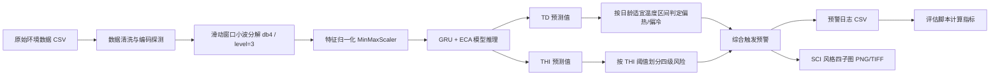
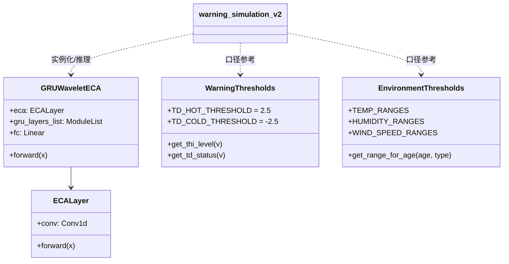

# 开发文档

> 面向对象：今后接手的老师或实验室研究生。读完本文应能理解系统如何运行、代码放在哪里、关键算法为何这样设计，并能定位到对应源码。

## 1. 项目概述

本项目是一个面向肉鸡养殖环境的**实时滚动预测与双指标预警原型系统**。核心做法是：

1. 采集鸡舍环境的时序数据（温度、湿度、CO2、风速、目标温度、日龄等）；
2. 对目标变量做滑动窗口小波分解，提取趋势与多尺度波动特征；
3. 使用 **GRU + ECA 通道注意力** 模型分别预测温度偏差 TD 与温湿指数 THI；
4. 按日龄对应的适宜温度区间判定 TD 偏热/偏冷，按 THI 阈值划分舒适/警告/危险/紧急；
5. 输出四子图 SCI 风格结果图、逐步预警日志与评估指标。

系统目前是**离线脚本式科研原型**，不是 B/S 架构的业务系统；没有数据库服务、没有 HTTP 后端和前端工程，交互入口是 Python 脚本与一个静态 HTML 展示页。

## 2. 开发思路框架



对应已有矢量图：`图文/framework_diagram.svg`（原项目 `framework_diagram.svg`）。

## 3. 技术栈

| 层次 | 技术 | 本机验证版本 |
|---|---|---|
| 编程语言 | Python | 3.10.19（conda 环境 `chicken_warn`） |
| 数据处理 | pandas | 2.3.3 |
| 数值计算 | numpy | 2.2.5 |
| 机器学习 | scikit-learn | 1.7.2 |
| 深度学习 | PyTorch | 2.10.0+cu126 |
| 小波分析 | PyWavelets | 1.8.0 |
| 可视化 | matplotlib / seaborn | 3.10.8 / 0.13.2 |
| 模型序列化 | PyTorch `.pth`（含 scaler 的 pickle） | — |
| 数据存储 | CSV 文件 | UTF-8-SIG / GBK |
| 展示页 | 静态 HTML | 无框架 |
| IDE | PyCharm / VS Code | 配置文件 `.idea` 已按用户要求清理，可重新生成 |

完整依赖见 `requirements.txt` 与 `06_依赖与环境.md`。

## 4. 模块设计

### 4.1 功能模块分解

| 模块 | 主要文件 | 职责 |
|---|---|---|
| 主仿真与预警 | `源码/warning_simulation_v2.py` | 读取数据、特征工程、两模型推理、预警判定、结果可视化与日志导出 |
| 预警规则库 | `源码/monitoring_warning_system.py` | 日龄-环境适宜区间、TD/THI 阈值与等级判定、温差分析类定义 |
| 评估 | `源码/eval_warning_v2.py`、`源码/calc_warning_metrics.py` | 读取仿真日志，计算回归/分类/二分类预警指标 |
| 多模型对比 | `源码/multi_model_comparison_final.py` | 在同一测试集上加载多个已训练模型，输出对比图与指标 |
| 训练 | `源码/THI/*/gru.py`、`源码/温度偏差预测/*/gru.py`、`lstm.py`、`tcn.py`、`XGboost/xgboost.py` | 各结构模型的训练与权重保存 |
| 推理/预测 | 对应目录下的 `*model.py` | 加载权重与 scaler，对新数据做预测 |
| 相关性分析 | `源码/correlation_analysis.py`、`源码/相关性分析/correlation_analysis.py` | Pearson 相关矩阵、热力图、散点图、强相关筛选 |
| 论文配图 | `源码/make_svgs.py`、`svg_parts.py`、`picture.py`、`gen_framework.py`、`generate_svgs.py` | 生成框架图与摘要图 SVG / PNG |
| 检查点检查 | `源码/inspect_ckpt.py`、`inspect_ckpt.bat` | 打印 `.pth` 内参数名与形状 |
| 调试工具 | `源码/debug_csv.py`、`read_data.py`、`plot_weekly_data.py` | CSV 编码探测、数据读取验证、周趋势绘图 |

### 4.2 核心类与关键函数

| 文件 | 名称 | 作用 |
|---|---|---|
| `warning_simulation_v2.py` | `GRUWaveletECA` | ECA 注意力 + 多层 GRU + 全连接输出，取末时间步预测 |
| 同上 | `make_wavelet_features` | 对目标列做滑动窗口 db4 三层分解，生成 approx/detail 特征 |
| 同上 | `load_data` | 多编码/多分隔符稳健读取 CSV，兼容 10/11 列格式 |
| 同上 | `load_model` | 从 `.pth` 读取配置并实例化模型，加载权重后设为 eval |
| 同上 | `classify_td` | 按日龄适宜温度上限/下限 ± 预警裕度换算 TD 阈值并判状态 |
| 同上 | `classify_thi` | THI <70 舒适、<76 警告、<81 危险、否则紧急 |
| 同上 | `plot_results` | 生成四子图 SCI 风格结果图，同时保存 PNG 与 TIFF |
| `monitoring_warning_system.py` | `EnvironmentThresholds` | 按日龄查询温度/湿度/风速适宜范围，CO2 上限固定 1500 ppm |
| 同上 | `WarningThresholds` | TD 固定阈值 ±2.5℃；THI 四级阈值 74/78/82 |
| 同上 | `EnvironmentMonitor` / `WarningSystem` | 环境监测历史、前后/左右温差分析、预警逻辑封装 |
| `eval_warning_v2.py` | `main` | 评估主流程：读日志 → 重算等级 → 指标 → 导出结果 |

### 4.3 类图 / 流程图

主程序是过程式脚本 + 类定义混合风格。关键调用关系：



> 说明：`warning_simulation_v2.py` 的 TD 阈值来自日龄适宜温度区间动态换算，与 `WarningThresholds` 中的固定 ±2.5℃ 并不完全一致；详见 `08_已知问题与待补项.md`。

## 5. 数据库设计文档

本项目**没有使用关系型数据库或 NoSQL 数据库**，因此无表结构、索引、存储过程、触发器或 ER 图。数据以 CSV 文件形式存放，按业务用途分文件：

- 训练数据：`数据/温湿度数据111.csv`
- 测试数据：`数据/部分温湿度数据.csv`
- 仿真日志：`数据/warning_simulation_log.csv`
- 带等级明细：`数据/warning_simulation_log_with_levels.csv`
- 评估指标：`数据/warning_metrics_result.csv`

字段说明见 `05_数据与数据字典.md`；CSV 即为本项目的“数据表”，无需执行 Restore 或迁移。

## 6. 项目结构层次

本系统不采用 View/Controller/Model 三层 Web 结构。对应到脚本式原型的层次为：

| 层次 | 对应内容 |
|---|---|
| View（展示） | `源码/monitoring_system.html`、`图文/*.png`、仿真结果图 |
| Controller（流程控制） | `源码/warning_simulation_v2.py` 的 `main()`、`eval_warning_v2.py` 的 `main()` |
| Model（数据与算法） | `GRUWaveletECA`、`make_wavelet_features`、阈值类、`.pth` 权重与 scaler |

## 7. 关键算法模块说明

### 7.1 小波分解

对目标列（TD 或 THI）按滑动窗口做 `db4` 小波、`level=3` 分解，得到 1 个近似系数和 3 个细节系数；其余原始特征保持不变。这样既保留趋势信息，又保留不同尺度的波动信息。

选择窗口长度与是否泄漏由检查点中的 `wavelet_window` 与 `no_data_leakage` 决定；主模型均为 `no_data_leakage=True`，即不使用未来信息。

### 7.2 ECA 通道注意力

`ECALayer` 使用一维卷积学习各输入通道的权重，再乘回原特征。相比 SE 注意力，ECA 不降维，参数量很小，适合本项目的 7~8 维输入。

### 7.3 GRU 预测头

ECA 输出进入一层或多层 GRU（隐藏维 128），取最后一个时间步的隐状态接 `Linear(hidden, 1)` 输出单个回归值。检查点中 TD 模型输入 8 维、THI 模型输入 7 维，时间窗均为 36。

### 7.4 预警判定

- TD：由日龄适宜温度区间上下限 ± 裕度换算成 TD 阈值，再判偏热/正常/偏冷；
- THI：主仿真脚本用 `<70 / <76 / <81 / ≥81` 四级；规则库类用 `≤74 / ≤78 / ≤82` 四级；
- 综合预警：TD 非 0 或 THI 等级 ≥1 即触发。

## 8. API 接口文档

本项目**不提供对外 HTTP API**，没有 Base URL、认证方式或 REST 端点。模块间调用通过 Python 函数实现，等价于“内部 API”。

### 内部 API 列表

| 调用方 | 被调用接口 | 输入 | 输出 |
|---|---|---|---|
| `main()` | `load_data(path)` | CSV 路径，可选 | 清洗后的 DataFrame |
| `main()` | `load_model(path, tag)` | `.pth` 路径、标签 | `(model, checkpoint_dict)` |
| `main()` | `make_wavelet_features(df, target_col, wavelet, level, window)` | 原始特征 DataFrame | 小波特征 DataFrame |
| `main()` | `batch_predict(model, data_norm, time_step, batch_size)` | 模型、归一化数据、窗口长度 | 一维预测数组 |
| `main()` | `classify_td(td_pred, target_temp, age)` | 预测偏差、目标温度、日龄 | `(状态, 等级, 偏热阈值, 偏冷阈值)` |
| `main()` | `classify_thi(thi_val)` | THI 数值 | `(状态, 等级)` |
| `main()` | `plot_results(res, output_path)` | 结果 DataFrame、输出路径 | 保存 PNG/TIFF |
| `eval_warning_v2.main()` | 指标计算函数 | 日志 DataFrame | 指标字典与输出 CSV |

### 调用示例

```python
import pandas as pd
from warning_simulation_v2 import load_model, batch_predict, classify_thi

model, ck = load_model('模型权重/温度偏差预测/gru+小波+eca/Model_GRUWavelet_no_leakage_pytorch.pth', 'TD')
# data_norm 为归一化后的特征 DataFrame，time_step 取自 ck['time_step']
# preds = batch_predict(model, data_norm, ck['time_step'])
print(classify_thi(75.8))  # ('警告', 1)
```

错误响应在 Python 层表现为异常：`FileNotFoundError`（文件不存在）、`ValueError`（无法读取或列缺失）、`SyntaxError`（残缺脚本）。无 HTTP 状态码。

## 9. 安全性设计

- 无用户注册、登录、Token 或二次验证；
- 无对外网络服务，不涉及 API Key / OAuth / JWT；
- `.pth` 检查点使用 `torch.load(..., weights_only=False)`，包含 pickle 对象，`**只应加载来源可信的权重文件**；
- 若后续做 Web 化，需补充身份认证与权重文件校验。

## 10. 术语表与数据字典

见 `05_数据与数据字典.md` 与 `09_学习文档.md`。摘要：

| 术语 | 含义 |
|---|---|
| TD | Temperature Deviation，当前温度与目标温度之差 |
| THI | Temperature Humidity Index，温湿指数 |
| ECA | Efficient Channel Attention，高效通道注意力 |
| GRU | Gated Recurrent Unit，门控循环单元 |
| db4 / coif3 / sym5 / haar | 常用小波基函数 |
| no_data_leakage | 小波分解不使用未来窗口数据 |

## 11. 与系统源代码的对应关系

| 文档章节 | 对应源码 |
|---|---|
| 主流程 | `源码/warning_simulation_v2.py` |
| 预警规则 | `源码/monitoring_warning_system.py` |
| 模型结构 | `warning_simulation_v2.py` 第 110 行起 `GRUWaveletECA`；训练版本在各 `gru.py` / `grumodel.py` |
| 数据与字段 | `源码/correlation_analysis.py`、`05_数据与数据字典.md` |
| 评估 | `源码/eval_warning_v2.py`、`源码/calc_warning_metrics.py` |
| 配图 | `源码/make_svgs.py`、`svg_parts.py` |

## 12. 如何编译打包

本项目为 Python 脚本，**无需编译**。若需交付可执行程序，可使用 PyInstaller（以下命令未在本环境执行，仅作方案）：

```bash
pip install pyinstaller
pyinstaller --onefile --add-data "模型权重;模型权重" --add-data "数据;数据" 源码/warning_simulation_v2.py
```

注意：需把脚本中的硬编码数据路径改为相对路径后再打包。当前归集包中**未附带 exe/Jar/War 制品**。
